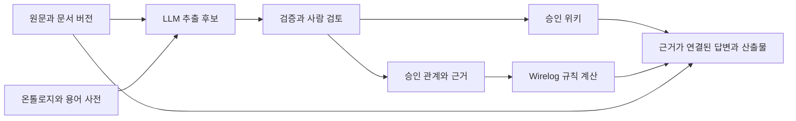

# Verinote와 LLMWiki 데모 분석 및 경영시스템 앱 설계 방향

분석 기준일: 2026년 10월 22일

**벤치마킹 방향은 `llmwiki-demos`의 지식 처리 흐름과 `verinote`의 승인·버전·근거 추적 구현을 결합하고, 그 위에 경영시스템 전용 온톨로지와 검증 규칙을 설계하는 것이다.** 두 프로젝트는 실제 Wirelog 계산을 사용한다. 현재 구현의 중심은 승인된 관계의 경로 조회이며, ISO 요구사항과 운영 증거의 충족 여부를 판정하는 기능은 별도 개발이 필요하다.

이 분석은 매뉴얼·절차서·지침서 작성이 끝난 뒤 앱을 개발할 때 사용할 참고 자료다. 프로젝트의 현재 구현과 향후 설계 제안을 구분한다. ISO 조항의 적합성 판정이나 기존 문서 전체의 심사를 수행한 보고서는 아니다.

| 분석 대상 | 확인한 로컬 커밋 | 성격 |
| --- | --- | --- |
| `/Users/y/dev/llmwiki-demos` | `dbcfd6356560fec30f8329e99e30d4fc26e5f016` | 단계별 교육 실습과 자연어 질의 통합 데모 |
| `/Users/y/dev/verinote` | `49281aec03089e1a18a5b0f4af9b04482d9f1685` | 임의 문서를 등록·추출·검토·조회하는 단일 사용자 로컬 앱 |
| `/Users/y/dev/iso-agent` | 현재 작업 파일 | 향후 적용할 문서 계층과 메타데이터의 사례 |

## LLMWiki와 Wirelog의 역할

LLMWiki는 원문을 읽어 지속적으로 유지하는 지식 페이지로 정리하는 방식이다. 원문과 별도로 개체 설명, 주제별 정리, 상호 참조와 분석 결과를 축적한다. 이 원형은 특정 데이터베이스나 추론 엔진을 필수로 지정하는 제품 사양이 아니다. [Karpathy의 LLM Wiki 설명](https://gist.github.com/karpathy/442a6bf555914893e9891c11519de94f)

Wirelog는 선언한 사실과 Datalog 규칙을 평가하는 엔진이며, 두 프로젝트는 Python 인터페이스인 PyreWire를 통해 사용한다. 공식 API의 `EasySession`은 사실 추가·철회, 전체 관계 조회와 증분 결과 조회를 제공한다. 두 앱이 실제로 사용하는 범위와 엔진 자체의 기능 범위는 구분해야 한다. [PyreWire 공식 설명](https://github.com/semantic-reasoning/PyreWire#readme), [Wirelog 공식 설명](https://github.com/semantic-reasoning/wirelog#readme)

| 구성 요소 | 담당하는 일 | 그 자체로 보장하지 않는 것 |
| --- | --- | --- |
| LLM | 문서 해석, 용어·관계 후보 추출, 위키와 답변 작성 | 의미적 정확성, 실제 업무 수행 여부 |
| LLMWiki | 읽기 쉬운 지식의 축적과 탐색 | 형식적 온톨로지, 모든 관계의 논리적 검증 |
| 온톨로지·사전 | 개체 종류, 관계 의미·방향, 정규 명칭 정의 | 사전에서 허용된 관계가 현실에서도 참이라는 보증 |
| 사람 검토 | 후보의 채택·반려·보류와 판단 이유 기록 | 승인된 문장과 실제 이행 증거의 자동 동일시 |
| Wirelog | 주어진 사실과 규칙으로 관계·조건 계산 | 입력 사실의 진실성, 자동 ISO 적합성 판정 |
| 저장·버전 계층 | 원문, 승인 상태, 계산 기준, 이력 보존 | 인증된 서명, 영구적 감사 증거 보존 정책 |

앱에서 필요한 연결은 다음과 같다. 위키는 설명을 담당하고, 승인된 구조 데이터는 계산을 담당하며, 둘 다 같은 원문 버전과 근거를 참조해야 한다.



## llmwiki-demos의 구현

### 단계별로 보여 주는 지식 처리 흐름

| 구성 | 실제 처리 | 벤치마킹할 요소 |
| --- | --- | --- |
| part01 | 원문 분할 → 청크별 근거 추출 → 근거 선택 → Markdown 위키 작성 | 원문 위치·해시, 정확한 인용, 선택·제외 근거 기록 |
| part02 | 타입·관계·질문 사전과 설계 판단 작성 | 앱의 질문에서 출발해 최소 온톨로지를 정하는 방식 |
| part03 | 관계 후보·개체·별칭 추출, SQLite 검토 이력, 승인 파일 내보내기 | 후보와 승인 분리, 수정 후 재승인, 오래된 승인 파일 차단 |
| part04 | 승인 사실을 실제 Datalog로 조회 | 직접 관계와 관계 방향, 오류와 빈 결과의 구분 |
| part05 | S1·S2·S3 비교, 별도 증분 추가·철회 실습 | 현재 기준과 변경 시나리오의 분리 |
| part06 | 그래프 결과와 원문 문맥을 근거 묶음으로 구성 | 구조 계산과 자연어 설명을 함께 제공 |
| part07 | 고정된 여섯 번의 읽기 도구 실행과 로그 | 호출 예산, 도구 입력·결과, 경로 근거 추적 |
| part08 | 최종 답변·주장표·분석 위키·변경 diff 작성 | 지식 환류, 초안 상태, 사실·해석·제안·미확인 구분 |
| llmwiki-wirelog | LLM이 읽기 도구를 선택하는 웹·CLI 질의 | 제한된 도구 선택, 인용 ID 검증, 실행 기록 |

이 흐름은 하나의 완전한 제품 파이프라인으로 연결된 것은 아니다. 후반 교시에는 교육용 체크포인트와 승인 예시가 기본 입력으로 사용된다. 앞 단계에서 새로 생성한 후보가 다음 단계의 운영 사실로 자동 승계되는 구조로 해석하면 안 된다. 특히 part07의 고정 계획과 통합 데모의 LLM 도구 선택은 서로 다른 구현이다. [루트 안내](/Users/y/dev/llmwiki-demos/README.md:36), [고정 실행 계획](/Users/y/dev/llmwiki-demos/shared/collaborate.py:8), [통합 도구 루프](/Users/y/dev/llmwiki-demos/llmwiki-wirelog/llmwiki/agent.py:85)

### 원문과 위키를 분리하는 방식

`raw/`는 원문, `wiki/`는 생성한 설명과 분석, `index.md`는 탐색 입구, `log.md`는 작업 기록이다. part01은 원문을 나누면서 출처·위치·해시를 붙이고, 인용이 해당 청크에 존재하는지 확인한다. 근거 선택 단계에서 제외한 ID도 남기므로 최종 페이지가 원문의 모든 정보를 포함한다고 오해할 가능성을 줄인다. [청킹 구현](/Users/y/dev/llmwiki-demos/part01/chunk_pipeline.py:54), [운영 설명](/Users/y/dev/llmwiki-demos/part01/README.md:41)

part08은 분석 페이지와 링크·로그를 갱신하고 diff를 만든다. 생성 페이지에는 검토 대기 상태가 표시된다. 다만 파일을 초안 영역에서 승인 영역으로 승격하는 문서 발행 상태 머신은 없으며, 실제 위키 파일에 초안을 기록한다. ISO 통제 문서의 발행 절차로 사용하려면 승인과 시행을 별도로 제어해야 한다. [위키 갱신 구현](/Users/y/dev/llmwiki-demos/part08/run_lesson8.py:35), [생성 분석 페이지](/Users/y/dev/llmwiki-demos/part08/wiki/analysis/ledger-impact-S1b.md:3)

파일 저장과 내용 검증의 순서도 교시별로 다르다. part01은 최종 내용을 검증한 뒤 파일을 교체하지만, part03 등 공통 실행기를 직접 사용하는 흐름은 모델 출력을 저장한 뒤 내용 검사를 한다. 후자의 검증 실패 시 잘못된 새 출력이 현재 파일로 남을 수 있다. 제품에는 검증을 통과한 결과만 현재 지식으로 승격하는 순서를 적용하는 것이 적절하다. [공통 실행기의 저장](/Users/y/dev/llmwiki-demos/shared/run_prompt.py:123), [후속 검증](/Users/y/dev/llmwiki-demos/part03/run_lesson3.py:99), [part01의 검증 후 저장](/Users/y/dev/llmwiki-demos/part01/chunk_pipeline.py:281)

### 온톨로지와 승인 사실의 범위

타입·관계 CSV에는 Service, API, Team, Document 등의 개념과 `depends_on`, `calls_api`, `api_of`, `owned_by`, `about` 관계가 있다. 그러나 실제 그래프 입력 검증은 다섯 서비스와 `Service → depends_on → Service`에 한정된다. 개체·별칭·API·팀 사전 전체가 자동으로 Datalog 관계가 되는 구조는 아니다. `about`도 별도로 준비한 문서 링크다. [관계 사전](/Users/y/dev/llmwiki-demos/part03/ontology/relations.csv:1), [검증과 사실 변환](/Users/y/dev/llmwiki-demos/shared/lab.py:73)

따라서 이 프로젝트의 온톨로지는 주로 추출·검토를 안내하는 명세다. CSV를 바꾸면 검증기와 추론 규칙까지 자동 변경되는 범용 온톨로지 시스템으로 보기는 어렵다.

반면 **part03의 검토 수명주기는 재사용 가치가 높다.** 후보 revision, 검토자, 판정 이유, 검토한 payload 해시를 관리한다. 수정·재개 시 기존 승인을 그대로 사용하지 않으며, 승인 내보내기와 현재 검토 상태의 일치 여부를 확인한다. SQLite 트리거로 검토 revision·decision 이력의 수정·삭제도 막는다. 다만 검토자 문자열은 인증된 신원이 아니고, 별도 외부 JSONL을 받는 경로의 신뢰 정책은 추가로 정해야 한다. [검토 저장소](/Users/y/dev/llmwiki-demos/part03/review_workflow.py:100), [승인 내보내기 검증](/Users/y/dev/llmwiki-demos/part03/review_workflow.py:277)

이 검토 해시는 후보 payload를 고정하며 원문 파일 전체 bytes를 고정하지는 않는다. 인용문 외부의 원문 변경이 반드시 재검토를 유발하는 것은 아니다. ISO 앱에서는 후보 해시와 원문 버전·전체 파일 해시를 함께 연결해야 한다. [원본 후보 비교](/Users/y/dev/llmwiki-demos/part03/review_workflow.py:144)

### Wirelog가 실제 계산하는 내용

`shared/query.py`는 `EasySession`을 열어 실제 `snapshot()`을 호출한다. 계산 결과를 정답 파일로 대체하는 fallback은 없다. 승인 사실은 Datalog 입력으로 변환하고, 재귀 규칙으로 서비스 간 도달 가능성을 구한다. [엔진 연결](/Users/y/dev/llmwiki-demos/shared/query.py:26)

```text
reach(X,Y) :- depends_on(X,Y).
reach(X,Z) :- depends_on(X,Y),reach(Y,Z).
candidate(S) :- reach(S,F),fail(F),S != F.
```

이는 장애 서비스에 도달하는 서비스의 점검 후보를 계산한다. 관계 경로만으로 실제 장애 발생이나 전파를 확정하지 않는다. [추론 규칙](/Users/y/dev/llmwiki-demos/part05/rules.dl:1)

S1·S1b는 교육용 승인 예시이고 S2·S3는 설계 가정이다. 각 스냅샷 비교는 새 세션에서 전체 관계를 재계산한다. `insert/remove/step` 증분 처리는 별도의 `friend/mutual` 예제로 실제 시연하지만, 문서 변경과 파생 지식 갱신을 지속적으로 관리하는 서비스까지 구현하지는 않는다. [스냅샷 비교](/Users/y/dev/llmwiki-demos/part05/run_lesson5.py:20), [증분 예제](/Users/y/dev/llmwiki-demos/part05/session_delta.py:14)

### 통합 질의 데모의 범위

통합 데모의 LLM은 `search_documents`, `read_document`, `query_graph` 중 필요한 도구를 고른다. 검색은 로컬 키워드·별칭 검색이고, 그래프는 고정 연산 `upstream/downstream/direct/path/documents`를 받는다. LLM이 생성한 코드를 실행하지 않는다. 한 질문의 예산은 모델 6회, 도구 12회다. [도구 계약과 호출 한도](/Users/y/dev/llmwiki-demos/llmwiki-wirelog/llmwiki/agent.py:14), [검색 구현](/Users/y/dev/llmwiki-demos/llmwiki-wirelog/llmwiki/corpus.py:50)

그래프는 준비된 네 스냅샷과 다섯 서비스만 지원한다. 담당 팀·API·운영 조건은 원문을 통해 설명한다. 위키는 미검토 초안이므로 최종 주장은 원문 또는 실제 그래프 근거를 함께 인용해야 한다. 이 규칙은 인용의 존재와 종류를 검증하며, 인용이 주장 내용을 실제로 뒷받침하는지까지 자동 판정하지는 않는다. [그래프 범위](/Users/y/dev/llmwiki-demos/llmwiki-wirelog/llmwiki/graph.py:6), [답변 검사](/Users/y/dev/llmwiki-demos/llmwiki-wirelog/llmwiki/agent.py:133)

## Verinote의 구현

### 교육 패턴을 문서 처리 앱으로 확장

Verinote는 데모를 실행 의존성으로 사용하지 않는다. 데모에서 배운 청킹·인용·승인·스냅샷 원칙을 독립된 앱으로 옮겼다. 주요 흐름은 다음과 같다. [적용 기록](/Users/y/dev/verinote/docs/learning-notes.md:3)

1. 원본 파일 또는 텍스트를 등록하고 문서 ID·버전·SHA-256를 부여한다.
2. 해당 문서에서 개체·별칭·관계 사전 후보를 만든다.
3. 사람이 사전을 검토하고 승인한다.
4. 승인 사전을 고정한 뒤 위키 주장과 관계 후보를 추출한다.
5. 위키와 관계를 각각 검토·승인한다.
6. 승인 지식을 스냅샷으로 고정해 관계 질의와 자연어 답변에 사용한다.

사전 승인과 관계 승인은 별개다. 승인 사전은 추출에 사용할 어휘를 제한하고, 사실 승인은 그 어휘로 만든 주장을 채택하는 단계다.

앱은 Python 표준 HTTP 서버, SQLite, HTML·JavaScript 화면으로 구성되고 `127.0.0.1`에서 실행된다. 화면에는 문서 목록, 원문·개정 비교, 사전 검토, 개별·일괄 승인, 관계 조회와 실행 기록이 있다. CLI 제공자 다섯 종류와 OpenRouter API를 지원하며, 선택한 제공자에게 문서·질문을 전달하는 구조다. 로컬 앱이라는 설명이 모델 추론까지 로컬에서 수행한다는 의미는 아니다. 현재 UI에는 ISO 요구사항 추적표나 도메인 온톨로지 편집기가 없으므로 이 부분은 새로 설계할 대상이다. [서버](/Users/y/dev/verinote/verinote/server.py:268), [제공자 목록](/Users/y/dev/verinote/verinote/agents.py:20), [현재 화면 구성](/Users/y/dev/verinote/verinote/web/index.html:3)

### 원문과 지식의 저장 구조

| 저장 단위 | 주요 내용 |
| --- | --- |
| documents / versions | 논리 문서, 현재 버전, 원본 bytes, 추출 text, 파일명, 해시 |
| items | ontology, page, fact 후보·승인 항목과 revision |
| events | 각 판정 당시 payload, 행위자, 이유, 시각 |
| runs | 모델 실행, 처리 상태, 고정한 사전과 실행 조건 |
| snapshots | 승인 사실·위키·사전 및 문서 메타데이터 |
| questions / queries | 자연어 질문과 구조 질의의 기준·결과 |

실제 지식은 SQLite에 JSON payload로 저장된다. 위키 항목은 `title`과 `claims[{heading,text,quote}]`이며, 한 문서의 추출 결과를 묶은 페이지다. Markdown 파일의 다중 문서 주제 페이지를 지속적으로 합성하는 원형 LLMWiki와 저장·갱신 방식이 다르다. [DB 구조](/Users/y/dev/verinote/verinote/store.py:36), [위키 구조](/Users/y/dev/verinote/verinote/service.py:54), [위키 읽기](/Users/y/dev/verinote/verinote/assistant.py:110)

### 사전으로 추출을 제한하는 방식

사전은 다음 구조를 가진다.

```text
entity   = id, name, type, quote
alias    = alias, entity, quote
relation = id, description, subject_types, object_types, quote
fact     = subject, predicate, object, quote
```

승인된 개체·별칭과 관계만 사실에 사용할 수 있고, 관계 양끝의 타입을 검사한다. 별칭은 정규 ID로 변환한다. 예를 들어 관계가 `Procedure → requires_record → RecordTemplate`으로 정의되었다면 그 방향과 타입을 확인하는 데 활용할 수 있다. 이 ISO 예시는 향후 사전 설계안이며 현재 등록된 도메인 모델은 아니다. [사전 검증](/Users/y/dev/verinote/verinote/ontology.py:82), [어휘·방향 검사](/Users/y/dev/verinote/verinote/ontology.py:162)

현재 사전은 문서별이다. 전역 개체 레지스트리와 문서 간 정의 충돌 해결 기능은 없다. 다른 조직의 같은 이름이 하나로 합쳐지거나, 같은 실체가 문서마다 다른 ID를 받아 연결되지 않는 문제는 별도로 해결해야 한다.

추출 시에는 승인 관계별로 추출 여부와 미표현 이유 등을 보고하게 한다. 이 coverage 검사는 누락 보고의 형식을 점검하는 장치다. 실제 의미 추출의 완전성을 측정한 정확도·재현율은 아니다. 사전 생성 중 근거가 잘못된 항목을 제외하고 진행하는 경우도 있으므로 성공 상태와 제외 보고서를 함께 보아야 한다. [추출 점검](/Users/y/dev/verinote/verinote/extraction_coverage.py:27), [사전 항목 필터](/Users/y/dev/verinote/verinote/dictionary_filter.py:64)

### 승인된 지식을 먼저 조회

자연어 질문에는 승인 위키·사전·관계와 문서 메타데이터를 고정한 스냅샷을 제공한다. LLM은 그래프와 승인 지식을 조회하고, 위키로 충분하지 않을 때 정해진 이유와 선행 조회 근거를 제시해 원문에 접근한다. 원문 내용은 미검토 원문 기술로 구분한다. 데모의 원문 중심 답변에서 승인 지식 우선 답변으로 발전한 부분이다. [원문 접근 검사](/Users/y/dev/verinote/verinote/assistant.py:210)

최종 답변의 근거 유형은 `graph`, `wiki`, `source`, `inference`다. 실제 그래프 실행 없이 최종 답변할 수 없고, 빈 그래프를 긍정 주장 근거로 사용할 수 없다. 검색 결과와 사전 정의는 탐색 안내이며 그 자체로 관계 사실의 근거가 되지 않는다. [도우미 계약](/Users/y/dev/verinote/verinote/assistant.py:15)

승인 위키의 설명을 재사용하므로 반복 질문마다 원문 전체를 다시 해석하는 일을 줄이는 구조다. 다만 이 분석에서는 호출 비용 절감률이나 답변 품질 향상을 실측하지 않았다.

### Wirelog는 일반 triple의 경로를 계산

현재 `rules.dl`의 실질 규칙은 세 개다.

```text
direct(X,P,Y) :- edge(X,P,Y).
reach(X,P,Y) :- edge(X,P,Y).
reach(X,P,Z) :- edge(X,P,Y),reach(Y,P,Z).
```

PyreWire에 문자열을 `insert()`로 넣고 `snapshot()`으로 계산한다. LLM이 출력한 문자열을 실행 코드에 직접 보간하지 않으며, native 엔진 호출은 lock으로 직렬화한다. [규칙 파일](/Users/y/dev/verinote/verinote/rules.dl:1), [엔진 호출](/Users/y/dev/verinote/verinote/engine.py:31)

**현재 계산은 같은 predicate 안에서의 경로 연결이다.** `절차서 → requires_record → 기록양식`과 `기록 → instance_of → 기록양식`처럼 서로 다른 관계를 결합해 요구사항 증거를 찾는 규칙은 없다. 사전의 타입·설명도 Datalog 입력에 포함되지 않는다.

경로 설명은 Wirelog 내부의 전체 증명 계보가 아니다. Python의 너비 우선 탐색으로 승인 사실에서 선택한 최단 경로 하나를 fact ID 목록으로 재구성한다. 직접 관계는 이를 지지하는 여러 사실 ID를 제공한다. 여러 규칙을 결합하는 ISO 추론으로 확장할 때는 규칙 ID·전제 사실·도출 결과의 계보를 별도로 설계해야 한다. [경로 재구성](/Users/y/dev/verinote/verinote/engine.py:13)

## 두 프로젝트의 비교

| 기준 | llmwiki-demos | Verinote |
| --- | --- | --- |
| 주된 목적 | 원리를 단계별로 설명 | 임의 문서 처리의 반복 운영 |
| 위키 | 링크된 Markdown 파일 | DB의 승인 가능한 주장 페이지 |
| 온톨로지 | 교육용 CSV·JSON과 하드코딩 검증 | 문서별 생성·승인 사전과 타입 검사 |
| 개체 범위 | 서비스 다섯 개 중심 | 자유로운 개체·관계 이름, 전역 병합 없음 |
| 승인 | 교시별 검토·승인 예시, part03은 강한 revision 관리 | 사전·페이지·사실의 웹 검토, 개별·원자적 일괄 승인 |
| 버전 기준 | S1·S1b·S2·S3 교육 스냅샷 | 문서 버전과 승인 지식의 해시 스냅샷 |
| Wirelog | 고정 서비스 규칙, 일부 관계 결합, 증분 API 실습 | 일반 triple의 동일 관계 경로 |
| 질문 | part07 고정 계획 / 통합 데모 LLM 도구 선택 | 승인 지식 우선 LLM 도구 선택 |
| 검색 | 키워드·별칭, 일부 고정 문서 확장 | 문자열·정규화·문서명·사전 개체 탐색 |
| 근거 | 문서·버전·절·인용·사실 ID | 문서·버전·해시·인용·revision·사실 ID |
| 자연어 조회 범위 | 작은 고정 교육자료 | 문서 100개·사실 500개 등의 명시적 상한 |
| 제품 참고 가치 | 설계 순서와 반례·검증 사례 | 저장·승인·동시성·질의·실행 이력 구현 |

검색은 두 프로젝트 모두 임베딩 기반 검색으로 구현되어 있지 않다. 또한 RDF/OWL/SHACL 기반의 범용 온톨로지 처리기를 사용하는 구조도 아니다. 현재의 타입 사전과 Datalog 계산을 출발점으로 필요한 도메인 의미를 직접 모델링해야 한다. [데모 검색](/Users/y/dev/llmwiki-demos/llmwiki-wirelog/llmwiki/corpus.py:50), [Verinote 사전 모델](/Users/y/dev/verinote/verinote/ontology.py:19)

## ISO 앱에 적용하기 전에 보완할 부분

| 우선 항목 | 확인한 현재 동작 | 향후 설계 제안 |
| --- | --- | --- |
| 전역 개체 식별 | 그래프는 문서 구분 없이 subject/predicate/object 문자열을 결합 | 조직·적용범위·규격판을 포함한 ID와 공통 개체 레지스트리 |
| 관계 의미 | Verinote는 모든 선택 predicate에 경로 계산 가능 | 관계별 전이 허용 여부와 개별 추론 규칙 정의 |
| 조건과 시간 | 단순 triple에 의무·금지·예외·유효기간 필드 없음 | 조건·양태·유효기간·업무 범위를 구조화 |
| 시행본 관리 | 업로드 즉시 current_version 변경 | 최신 업로드와 현재 승인·시행본을 분리 |
| 변경 영향 | 이미 승인된 fact는 사전 승인 철회 후에도 유지 | 영향 분석 후 재검토 대상으로 전환하는 정책 |
| 이력 보존 | 문서 삭제 시 연결 스냅샷·질문·질의·이벤트 삭제 | 폐기·보관·접근 제한·물리 삭제를 구분 |
| 실행 재현 | 과거 사실 스냅샷을 현재 규칙·엔진으로 재평가 | 온톨로지·규칙·엔진 버전도 함께 고정 |
| 승인 신원 | 검토자 자유 입력 | 인증된 사용자, 역할·권한, 작성·검토·승인의 분리 |
| 근거 위치 | Verinote quote는 원문 substring, 페이지·표 위치 없음 | 문서 버전·절·페이지·표·셀·문자 범위 locator |
| 문서 형식 | PDF 텍스트, DOCX 본문 문단 중심 | 표 구조·부록·서명란·스캔 OCR의 별도 수집 경로 |
| 규모 | 자연어 질의 fact 500개 등 상한 | 적용범위·문서군별 조회, 인덱스, 질의별 근거 선택 |

시행본 관리에는 구체적인 차이가 있다. Verinote는 새 버전 등록 즉시 현재 버전을 바꾸며, 현재 스냅샷은 그 버전의 승인 항목만 가져온다. 따라서 개정본을 올리고 아직 승인하지 않은 동안 기존 버전의 승인 지식이 현행 조회에서 빠진다. 경영시스템 앱에는 `working_revision`과 `effective_revision`을 분리하는 설계가 적합하다. [등록 구현](/Users/y/dev/verinote/verinote/store.py:127), [현행 스냅샷 선택](/Users/y/dev/verinote/verinote/store.py:445)

승인 사전의 철회도 자동 전파되지 않는다. 추출 중 철회는 저장을 차단하지만, 이미 승인된 사실은 추출 당시 고정한 사전으로 검토할 수 있고 현행 그래프에도 남는다. 새 후보가 추가되어도 예전 승인 후보를 자동 대체하지 않는다. ISO 앱에서는 정의 변경으로 영향을 받는 주장·위키·발행 산출물의 재검토 목록이 필요하다. [저장 시 검사](/Users/y/dev/verinote/verinote/store.py:349), [기존 사실 재검토](/Users/y/dev/verinote/verinote/store.py:394), [해당 계약 테스트](/Users/y/dev/verinote/tests/test_ontology.py:185)

삭제 범위는 감사 기록 관점에서 특히 중요하다. 특정 문서가 스냅샷의 문서 목록에 포함되면 그 스냅샷을 사용한 질문·질의가 삭제 대상이다. 해당 문서를 답변에서 직접 인용했는지는 조건이 아니다. 원문과 관련 판정 이벤트도 삭제한다. 이 정책을 조직의 기록 보존 정책으로 그대로 옮기면 안 된다. [삭제 구현](/Users/y/dev/verinote/verinote/store.py:485)

과거 스냅샷을 조회하면 당시 사실은 복원되지만, 실행은 현재 설치된 규칙과 PyreWire를 사용한다. 저장 결과에 규칙 본문·해시·엔진 버전이 있다는 것과 과거 실행 환경을 자동 복원한다는 것은 다른 기능이다. [질의 진입점](/Users/y/dev/verinote/verinote/service.py:291), [현재 규칙 실행](/Users/y/dev/verinote/verinote/engine.py:9)

입력·조회 크기도 제한되어 있다. 원본은 32 MiB, 추출 텍스트는 128,000자, PDF는 200쪽이고 OCR은 없다. 자연어 질문은 문서 100개, 승인 사실 500개, 위키 500개, 사전 100개, 지식 8 MiB까지 받는다. 이는 엔진의 최대 성능을 측정한 수치가 아니라 앱의 보호 한도다. [문서 처리](/Users/y/dev/verinote/verinote/documents.py:9), [질의 한도](/Users/y/dev/verinote/verinote/assistant.py:84)

## 경영시스템 앱의 온톨로지 설계 제안

### 문서 계층과 운영 증거의 구분

현재 iso-agent의 매뉴얼은 매뉴얼·절차서·지침서의 계층을 정의하고, 방침·목표·평가 결과·적용성 기술서와 기록은 별도 관리하도록 서술한다. 또한 기능상의 역할과 실제 조직·담당자의 역할 부여를 구분한다. 이 구분을 데이터 모델에 유지하는 것이 좋다. [현재 문서 체계](/Users/y/dev/iso-agent/docs/manual/AIDU-AIM-01-01.md:46)

예를 들어 “AI 영향평가를 실시한다”는 절차의 요구, 빈 영향평가 양식, 특정 시스템에 대해 작성한 영향평가 결과는 각각 다른 개체다. 절차의 존재나 빈 양식만으로 영향평가가 실제 수행되었다고 결론 내리면 안 된다. 가상 회사 설정·예시 문서와 실제 운영 기록도 구분해야 한다. 현재 회사소개서 역시 가상 설정임을 명시한다. [회사소개서](/Users/y/dev/iso-agent/docs/aidu-company-profile.md:1)

| 개체 | 의미 | 예시 식별 방식 |
| --- | --- | --- |
| StandardEdition / Clause / Requirement | 규격판, 조항, 원자적 요구사항 | 규격 ID + 판 + 조항 + 요구사항 ID |
| ManagementSystem / Scope | 경영시스템과 적용범위 | 조직 ID + 시스템 ID + 범위 revision |
| Document / DocumentVersion / Section | 관리 문서, 개정본, 특정 절 | 기존 information_id + revision + section ID |
| Process / Activity | 업무 프로세스와 실행 단계 | 조직 공통 프로세스 ID |
| Role / Person / OrganizationUnit | 기능상 역할, 실제 사람, 부서 | 각 종류의 독립 ID와 역할 부여 기간 |
| Risk / Control | 평가한 위험과 처리 수단 | 위험대장·통제목록의 안정적인 ID |
| RecordTemplate / Record | 빈 양식과 실제 작성·수행 기록 | 양식 ID + 개별 기록 ID |
| Evidence / Assessment / Finding | 근거, 평가·심사 판단, 발견 사항 | 대상·범위·기간·근거 버전에 연결 |
| Action / Change | 후속 조치와 변경 | 책임자·기한·완료 근거·영향 대상 연결 |
| AISystem / Supplier / Dataset | AI 시스템, 공급자, 데이터셋 | 도메인별 등록 ID와 버전 |

이 표는 초기 설계 후보다. 모든 개체를 첫 버전에 구현하기보다, 실제 답해야 할 질문에 필요한 개체부터 확정한다.

### 관계를 먼저 정의하고 추론을 제한

| 관계 예시 | 의미 | 설계 시 구분할 점 |
| --- | --- | --- |
| addresses | 문서·활동이 요구사항을 다룸 | 다룬다는 사실과 충족 판단은 별도 |
| governed_by | 활동이 절차·지침의 통제를 받음 | 적용 중인 문서 버전과 범위 필요 |
| requires_record | 절차가 특정 기록을 요구함 | 기록의 실제 존재를 뜻하지 않음 |
| instance_of | 작성 기록이 특정 양식을 사용함 | 빈 양식과 작성 기록 구분 |
| evidence_for | 기록이 활동·평가의 근거 후보임 | 기간·대상·충분성 평가 필요 |
| assigned_to / holds_role | 업무·역할과 담당자 연결 | 역할과 사람, 담당 기간 분리 |
| mitigates | 통제가 위험을 다룸 | 통제의 실제 운영·효과성은 별도 증거 |
| approved_by | 특정 revision의 승인 주체 | 승인 대상·종류·시점·권한을 함께 보존 |
| supersedes | 새 개정본이 이전 개정본을 대체 | 승인일과 시행일을 구분 |
| depends_on | 변경 영향 분석의 의존 관계 | 방향·범위와 전이 허용 조건 정의 |

`approved_by`와 `assigned_to`를 일반 전이 관계로 다루면 안 된다. 문서 A를 역할 B가 승인하고 B가 다른 개체 C와 연결된다고 해서 C가 A를 승인했다고 추론할 수는 없다. 관계별 허용 추론을 명시하고 승인한 규칙만 실행한다.

여러 관계를 결합하는 계산은 다음처럼 좁은 질문에서 시작할 수 있다.

```text
요구사항 R을 다루는 절차 P가 있고,
P가 양식 T의 기록을 요구하며,
기간·범위 검사를 통과한 기록 E가 T를 사용했다면,
E를 R의 검토 대상 증거 후보로 제시한다.
```

이 결과의 명칭은 ‘증거 후보’가 적절하다. 활동의 실제 수행과 기록 내용의 충분성을 검토하기 전에는 ‘요구사항 충족’으로 승격하지 않는다. 미등록·미검토·기간 불일치·기록 없음·부적합도 각각 구분한다. 특히 조회 결과가 없다는 사실만으로 부적합이나 실제 부재를 확정하지 않는다.

### 사실의 종류와 승인 상태를 분리

하나의 `approved` 상태에 모든 의미를 넣지 않는 것이 중요하다. 다음 축은 독립적으로 저장하는 설계를 제안한다.

| 축 | 값의 예 |
| --- | --- |
| 지식 종류 | 규정된 요구, 관측·수행 기록, 해석, 제안, 가상 시나리오 |
| 추출 검토 | 검토 대기, 승인, 보류, 반려, 재검토 필요 |
| 문서 수명주기 | 작성 중, 검토 중, 승인됨, 시행 중, 대체됨, 폐기됨 |
| 적용 조건 | 조직, 시스템, 적용범위, 유효 시작·종료, 대상 기간 |
| 근거 품질 | 원문 위치 확인, 의미 검토 완료, 증거 부족, 상충 근거 존재 |

“절차에 이렇게 쓰여 있다”는 추출 승인은 그 절차가 실제 운영되고 있다는 확인과 다르다. 승인 문서의 의무도 특정 기간의 이행 증거와 별도로 유지한다.

### 원문에서 산출물까지 추적

주장·관계마다 다음 연결을 유지한다.

```text
주장 ID
  → 조직·적용범위·지식 종류·유효기간
  → 주체 ID·관계 ID·객체 ID
  → 원문 문서 ID·revision·SHA-256
  → 절·페이지·표·셀·문자 범위와 인용
  → 추출 실행·사용 모델·온톨로지 revision
  → 검토자·판정·판정 이유·판정 시각
  → 이를 사용한 규칙 결과·위키·발행 산출물
```

추론 결과에는 전제 주장 ID와 규칙 revision을 연결한다. 스냅샷에는 사실뿐 아니라 온톨로지·규칙·엔진 버전·적용범위·기준일을 포함한다. 위키는 이 승인 데이터를 읽기 쉽게 보여 주는 파생 표현으로 두고, 위키 문장 수정이 구조 데이터를 몰래 바꾸지 않도록 검토 흐름을 통일한다.

현재처럼 Markdown 문서가 중심이라면 우선 헤딩·표·frontmatter를 구조적으로 읽을 수 있다. 이미 있는 `information_type`, `information_id`, `information_title`, `author`를 활용하고, 존재하지 않는 시행일·승인자 값을 모델이 채우지 않도록 한다.

구체적인 검증 사례도 있다. `docs/procedure/AIDU-AIP-00.md`의 `information_id`는 현재 `AIDU-AIM-00`이다. 파일명과 메타데이터의 불일치를 탐지해 검토 대상으로 제시하는 기능은 의미 추론보다 먼저 구현할 수 있다. 어느 ID가 맞는지는 문서관리 규칙에 따라 결정해야 한다. [현재 메타데이터](/Users/y/dev/iso-agent/docs/procedure/AIDU-AIP-00.md:1)

## 문서 작업 완료 후의 개발 순서 제안

| 단계 | 만드는 기능 | 확인할 결과 |
| --- | --- | --- |
| 1. 문서 등록과 기준 확정 | 문서 ID·revision·절 구조·종류·시행 상태·범위 등록 | 같은 문서의 개정본과 서로 다른 문서를 구분 |
| 2. 공통 온톨로지와 검토 | 요구사항·절차·역할·양식·기록의 공통 사전, 후보 검토 | 문서마다 생성한 용어를 안정적인 공통 ID로 연결 |
| 3. 추적 관계와 규칙 | 요구사항 추적표, 변경 영향, 증거 현황 질의 | 기준 스냅샷과 원문까지 결과를 설명 |
| 4. 지식 탐색과 초안 | 주제별 승인 위키, 자연어 질문, 근거가 연결된 초안 | 규정·실행 기록·해석·미확인을 구분 |
| 5. 발행과 운영 | 검토·승인·시행, 권한, 기록 보존, DOCX/PDF 등 출력 | 발행본과 그 생성 기준을 재현하고 이력을 보존 |

첫 시제품의 대표 질문은 다음 세 가지로 좁히는 것이 좋다.

1. **요구사항 추적**: “이 요구사항과 연결된 매뉴얼·절차·지침·양식·실제 기록은 무엇인가?”
2. **변경 영향**: “담당 역할이나 절차를 개정하면 어떤 문서·위키·평가·기록을 재검토해야 하는가?”
3. **증거 현황**: “이번 평가 기간과 적용범위에서 확인한 증거와 아직 확인하지 못한 증거는 무엇인가?”

도입 초기에는 공통 개체·관계·검토·버전을 저장하는 DB와 읽기용 위키, 검토된 Datalog 규칙의 조합으로 시작할 수 있다. 그래프 DB나 RDF/OWL 채택 여부는 이 질문들에서 필요한 상호운용성·규칙·조회 규모를 확인한 뒤 결정한다. 기존 두 프로젝트에서 특정 데이터베이스의 대규모 성능이 검증되었다고 해석하지 않는다.

현재 문서 작성 단계에서는 안정적인 문서번호·절 구조·역할명·상호 참조를 유지하고, 가상 예시·제안·확인 필요 사항을 명확히 구분하는 것이 이후 추출에 도움이 된다. 앱 개발은 문서 체계가 정리된 뒤 시작한다는 사용자 계획을 전제로 한다.

## 실행 검증과 재현 범위

현재 로컬 코드에서 다음을 실행했다. 외부 LLM 또는 OpenRouter의 실제 생성 호출은 하지 않았다. 테스트의 모델 응답은 테스트용 대역을 사용하며, 관계 계산은 실제 설치된 PyreWire 1.1.2를 사용했다. Verinote 테스트는 별도 임시 가상환경에 `pypdf 6.21.2`를 설치해 실행했다. Python은 3.14.6이다.

| 확인 항목 | 이번 결과 |
| --- | --- |
| Verinote 전체 unittest | 346개 중 343개 통과, Windows 전용 3개 건너뜀 |
| Verinote 웹 JS 구문 검사 | 통과 |
| 데모 part01 청킹 테스트 | 21개 통과 |
| 데모 part03 검토 workflow 테스트 | 24개 통과 |
| 데모 엔진 버전 검사 테스트 | 3개 통과 |
| llmwiki-wirelog 통합 테스트 | 13개 통과 |
| 전체 `verify_demos.py` | 과거 LLM 13단계 성공 로그 확인 단계에서 실패 |

`verify_demos.py`는 마지막에 `verification.json`을 덮어쓰므로 임시 복제본에서 실행했다. 실제 스냅샷 관계 재계산·인용·승인 경계·증분 예제 검사를 지나, 105행의 `LLM 13개 단계의 실제 성공 기록` 검사에서 실패했다. `runs/`가 Git에서 제외되어 현재 제공된 로컬 파일만으로 해당 과거 실행 이력을 확인할 수 없었다. 저장소의 기존 `verification.json`에 있는 78개 검사 성공 기록은 이번 재실행 성공으로 제시하지 않는다. [검증 스크립트](/Users/y/dev/llmwiki-demos/verify_demos.py:100), [기존 검증 기록](/Users/y/dev/llmwiki-demos/verification.json:1)

이 실패는 Wirelog 관계 계산의 실패와 구분해야 한다. 재현 가능한 배포를 위해서는 생성 이력 검사와 배포된 자료·엔진 검사를 분리하거나, 필요한 실행 증거를 함께 제공하는 방식이 필요하다. README의 `demos/...` 실행 경로 역시 현재 독립 저장소의 루트 구조에 맞춰 해석해야 한다.

주요 재현 명령은 다음과 같다. 각 저장소의 의존성을 설치한 Python 환경에서 실행해야 한다.

```sh
# /Users/y/dev/verinote
python -B -m unittest discover -s tests -q
node --check verinote/web/app.js

# /Users/y/dev/llmwiki-demos
python -B -m unittest discover -s part01 -p 'test_*.py' -v
python -B -m unittest discover -s part03/tests -v
python -B -m unittest discover -s tests -v

# /Users/y/dev/llmwiki-demos/llmwiki-wirelog
python -B -m unittest discover -s tests -v
```

테스트 통과는 검토 상태·조회 경로·인용 구조 등의 구현 검증이다. 실제 ISO 문서에 대한 추출 품질, 복잡한 표 해석, 조직 운영 적합성, 대규모 성능은 별도의 평가 자료와 기준이 필요하다. 이번 분석은 두 원본 프로젝트의 코드를 수정하지 않았다.

## 재사용 시 확인할 라이선스

| 구성 | 확인한 라이선스 표기 | 근거 |
| --- | --- | --- |
| llmwiki-demos | Apache-2.0 | [LICENSE](/Users/y/dev/llmwiki-demos/LICENSE:1) |
| Verinote | MPL-2.0 | [LICENSE](/Users/y/dev/verinote/LICENSE:1) |
| PyreWire Python wrapper | Apache-2.0 또는 GPL-3.0 이상 선택 | [공식 라이선스 안내](https://github.com/semantic-reasoning/PyreWire#license) |
| Wirelog core | LGPL-3.0-or-later / Commercial 이중 라이선스 표기 | [공식 라이선스 파일](https://github.com/semantic-reasoning/wirelog/blob/main/LICENSE.md) |

아키텍처 참고와 코드를 복제·수정해 배포하는 것은 재사용 범위가 다르다. 실제 제품 배포 방식을 정할 때 각 구성의 원문 라이선스와 배포 대상 버전을 함께 확인해야 한다. 이 표는 표기의 확인이며 법적 의무에 대한 판단은 포함하지 않는다.
