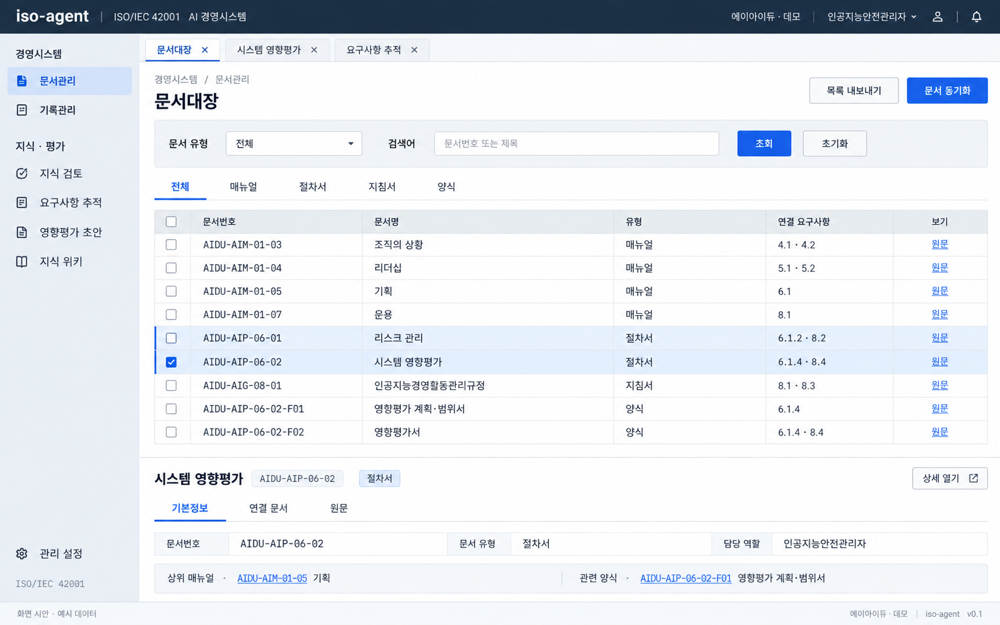
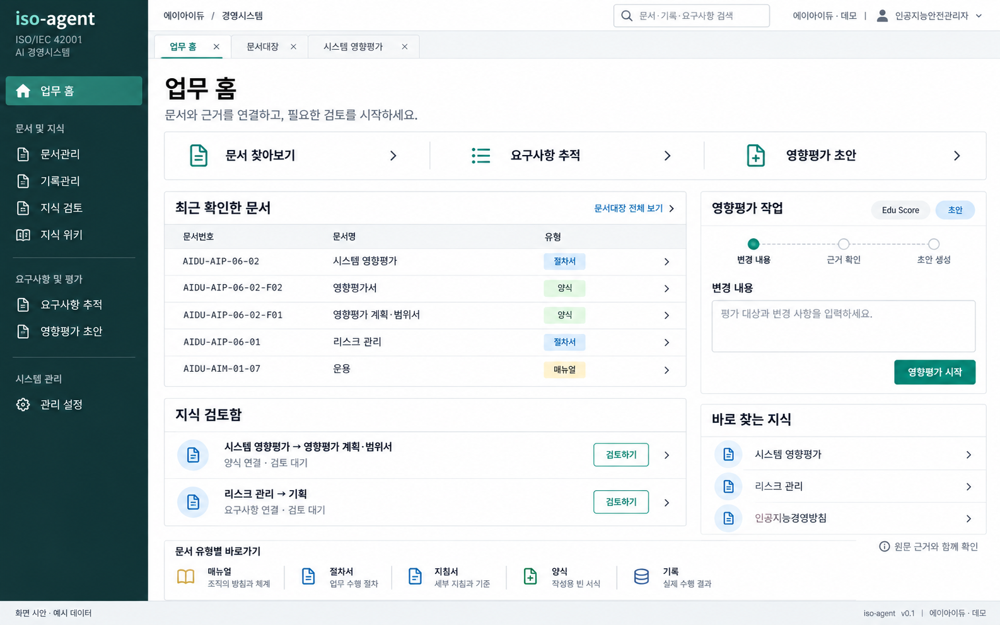
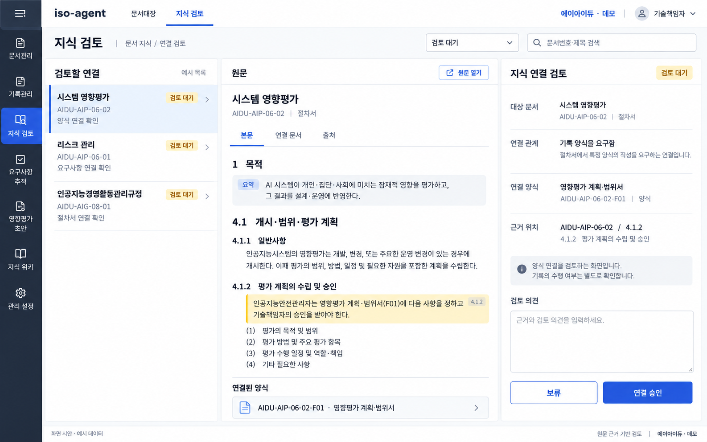
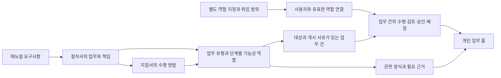
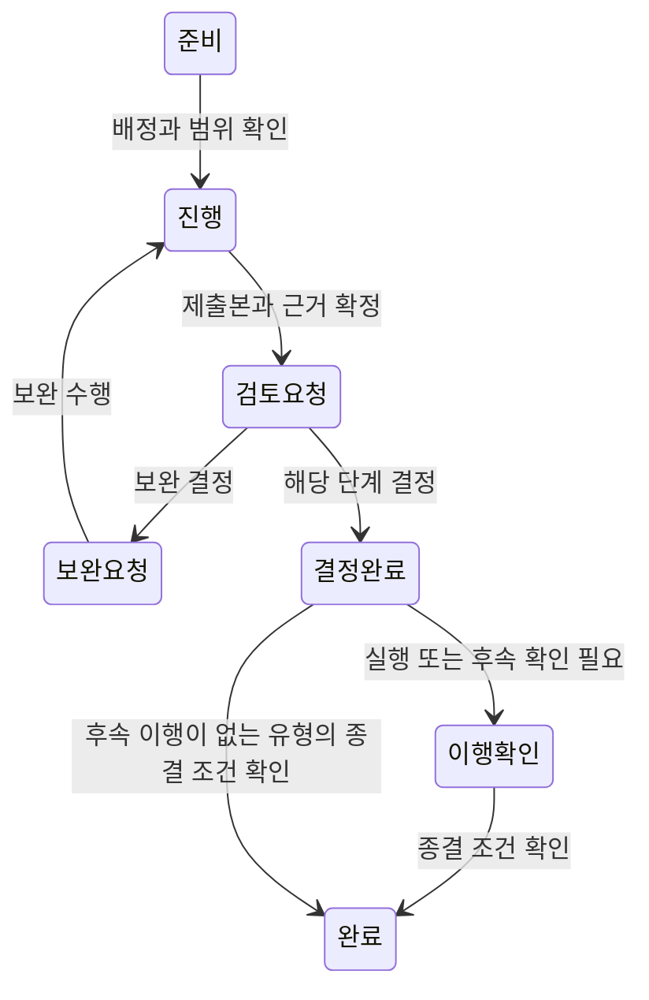

# iso-agent ERP 업무 홈 중심 UI 설계서

| 항목 | 내용 |
| --- | --- |
| 작성일 | 2026-10-22 |
| 버전 | 0.1 |
| 상태 | 화면 방향 확정, 상세 설계 검토안 |
| 현재 구현 확인 기준 | `f381ed3` 및 현재 작업 트리 |

**A의 ERP 공통 틀 안에 B의 업무 홈을 기본 진입 화면으로 두고, 검토·승인 상세에는 C의 목록·원문·판단 3영역 구성을 적용한다.** 업무 홈의 주목적은 사용자가 자신에게 지정된 기능상 역할에 따라 수행할 업무와 검토·승인 요청을 처리하는 것이다. 문서 조회와 지식 탐색은 이 업무를 지원한다.

업무 분장은 **저장소의 ISO 매뉴얼·절차서·지침서에 규정된 역할, 업무절차, 검토·승인 책임**을 기준으로 정의한다. 실제 조직도, 부서 인원, 직함 또는 페르소나의 성향으로 업무를 생성하거나 권한을 부여하지 않는다. 사용자를 기능상 역할에 연결하는 지정 정보는 별도로 관리한다.

이 설계서는 화면 구성, 이동, 업무 분장, 표시 데이터, 상태와 수용 기준을 정의한다. 업무 실행·배정·검토 이력 중 현재 구현에 없는 부분은 신규 기능으로 표시한다.

## 1. 확정한 화면 방향

| 기준 시안 | 채택 범위 | 통합 시 적용 기준 |
| --- | --- | --- |
| A 문서대장 중심형 | 상단 바, 왼쪽 메뉴, 작업 탭, 검색·필터, 표, 상세 영역 | 모든 화면의 공통 틀과 색상·간격·버튼 체계 |
| B 업무 포털형 | 업무를 시작하고 이어가는 홈의 정보 배치 | 첫 화면이자 주 화면. 중앙에는 내 업무, 오른쪽에는 담당 업무 시작과 검토 지원 |
| C 검토 작업대형 | 대기 목록, 원문·산출물, 검토·결정 패널 | 업무 검토와 지식 연결 검토에 공통 배치 사용. 두 검토의 권한과 상태는 분리 |

### 1.1 시안과 상세 설계의 관계

세 시안은 배치 참고이며, 아래 설계가 구현 기준이다. B의 녹색 사이드바와 C의 별도 상단 바를 그대로 혼합하지 않고 A의 남색 상단 바·밝은 사이드바·파란색 주요 버튼으로 통일한다. B에서 최근 문서가 있던 중심 영역을 **내 업무**로 확장하고 최근 문서는 보조 영역으로 옮긴다.

이미지에 표시된 이름·본문·상태·수치는 예시다. 실제 화면의 문서 내용과 업무 상태는 저장된 원문과 업무 데이터로 표시한다. B의 매뉴얼 설명은 `조직의 방침과 체계` 대신 `준수하여야 할 요구사항`으로 표기한다. C의 지식 검토에서 `보류`를 `반려` API로 처리하지 않는다.

| 참고 이미지 | 원본 크기 |
| --- | --- |
| [A 문서대장 중심형](../../../output/erp-ui-concepts/2026-10-22/a-document-register.png) | 1586 × 992 |
| [B 업무 포털형](../../../output/erp-ui-concepts/2026-10-22/b-work-portal.png) | 1586 × 992 |
| [C 검토 작업대형](../../../output/erp-ui-concepts/2026-10-22/c-review-workbench.png) | 1586 × 992 |







## 2. 업무 분장의 기준

### 2.1 요구사항에서 개인 업무 홈까지의 연결



- **매뉴얼**은 준수 요구사항과 기본 책임·권한을 제공한다.
- **절차서**는 업무 개시 조건, 순서, 수행·검토·승인 책임과 산출물을 제공한다.
- **지침서**는 자료 수집, 작성, 근거 확인, 협업, 후속 확인 방법을 제공한다.
- **양식**은 작성 구조다. 빈 양식의 존재를 업무 수행이나 기록 완료로 계산하지 않는다.
- **기록**은 개별 업무의 실제 수행 내용·결정·근거다. 존재와 승인 상태를 별도로 확인한다.

위 구분은 [문서체계](../../manual/AIDU-AIM-01-01.md), [조직 및 역할절차서](../../procedure/AIDU-AIP-05-02.md), [활동관리지침서](../../guide/AIDU-AIG-08-01.md)에 따른다. 원문에 등장하는 부서명은 아래 기능상 역할과 연결되는 출처 표현으로 보존하고, 메뉴와 업무 배정의 고정 조직 구조로 사용하지 않는다.

### 2.2 기능상 역할 목록

아래 명칭은 화면에서 업무 책임을 구분하기 위한 표준 표시명이다. `대표이사`·`기술책임자` 등 원문 역할은 유지하며, 부서별 실무는 기능명으로 정규화한다. 역할의 권한은 각 업무의 해당 조항까지 확인한다.

| 기능상 역할 | 주된 책임 | 주요 근거 |
| --- | --- | --- |
| 대표이사 | 방침·주요 목표·자원·주요 역할 승인, 경영검토, 상향 보고 결정 | AIP-05-01 3.1, AIP-05-02 3.1, AIP-06-03 3.1, AIP-09-03 3.1 |
| 기술책임자 | 기술 검토·승인, AIMS 성능 보고, 위임 범위 내 결정 | AIP-05-02 3.2, AIP-06-01 3.2, AIP-08-01 3.2 |
| 인공지능안전관리자 | 분장된 AIMS 실무의 주관·조정, 리스크·영향·준수 자료 취합 | AIP-05-02 3.3·4.2, AIG-08-01 3.3 |
| 영향평가 담당자 | 평가 범위·작동원리·피영향자·영향·후속 확인 관리 | AIP-06-02 3.3·4.1~4.5 |
| 문서·기록관리 담당자 | 문서대장, 배포·회수, 기록 등록, 보유·폐기 관리 | AIP-07-03 3.4·4.1~4.7; 원문의 총무팀 실무 |
| 교육·역량 운영 담당자 | 역량 증거, 교육 계획·실적, 인식 확인 | AIP-07-02 3.3·4.1~4.6; 원문의 총무팀 실무 |
| 자원 조정·관리 담당자 | 소요·가용성·조달·자원 상태 관리 | AIP-07-01 3.4·4.1~4.6; 자원 조정과 개별 자원 책임 범위 구분 |
| 공급자 계약 담당자 | 공급자 계약·조건 자료와 관련 의사소통 | AIP-07-03 3.4, AIP-08-01 3.4·4.5; 원문의 회계팀 실무 |
| 고객 의사소통 담당자 | 고객 요구·고지·불만·이의제기 접수와 전달 | AIP-08-01 3.4·4.5·4.8·4.11; 원문의 영업 실무 |
| 시스템 책임자 | 시스템 명세·수명주기 기록·미완료 사항 관리 | AIP-08-01 3.4, AIG-08-02 3.3 |
| 개발·데이터 담당자 | 설계·구현·데이터 처리와 개발 근거 작성 | AIP-08-01 3.4, AIG-08-02 3.3 |
| 운영·검증 담당자 | 시험·보호·배포·감시·복구·삭제와 관련 근거 작성 | AIP-08-01 3.4, AIG-08-02 3.3 |
| 리스크·조치 책임자 | 배정된 리스크 처리·기회 추진·시정조치 이행 | AIP-06-01 3.4, AIP-10-01 3.4 |
| 독립 검증자 | 구현 결과와 조치 효과성의 독립 확인 | AIP-06-01 3.4, AIP-10-01 3.4 |
| 심사 운영 담당자 | 심사 프로그램·일정·자료·후속조치 관리 | AIP-09-02 3.3 |
| 내부심사원 | 건별 배정 범위의 증거 수집·평가·보고와 후속 확인 | AIP-09-02 3.4·4.2 |
| 업무 책임자·수행자 | 소관 자료 제출, 수행·보고, 역량 확보, 지정 조치 이행 | 각 절차서 3.4, AIP-07-02 3.4 |

표의 `AIP`·`AIG`는 각각 `AIDU-AIP`·`AIDU-AIG`의 약칭이다. 여러 기능은 한 사람이 겸임할 수 있지만 역할별 업무·범위·이해충돌 조건은 유지한다. 인공지능안전관리자의 모든 실무를 한 사람에게 자동 집중시키지 않는다.

### 2.3 업무 유형과 절차 연결

다음은 업무 홈에서 시작하거나 배정받는 **업무 유형 카탈로그**다. 각 행은 진행 중인 업무 건이 아니다. `주관`만으로 승인권을 부여하지 않으며 검토·결정 경로는 개별 단계의 절차를 적용한다. 표의 양식은 연결 후보이며 조건부 양식은 적용 사유를 판단한 뒤 요구한다.

| 업무 유형 | 수행·주관 역할 | 검토·결정의 구분 | 근거와 연결 양식 |
| --- | --- | --- | --- |
| 조직상황·이해관계자·적용범위 | 인공지능안전관리자, 소관 업무 책임자 | 기술책임자 검토, 대표이사 승인 | [AIP-04-01](../../procedure/AIDU-AIP-04-01.md) 3·4; F01~F05 |
| 방침 수립·검토·전달 | 인공지능안전관리자, 문서·고객 의사소통 담당자 | 기술책임자 정합성 검토, 대표이사 방침 승인 | [AIP-05-01](../../procedure/AIDU-AIP-05-01.md) 3·4; F01~F03 |
| 역할 지정·인계·우려 보고 | 역할 운영을 맡은 문서관리 담당자, 업무 책임자 | 기술책임자 분장 검토, 대표이사 주요 지정·위임 승인 | [AIP-05-02](../../procedure/AIDU-AIP-05-02.md) 3·4; F01~F04 |
| 리스크 평가·처리·SoA | 인공지능안전관리자, 리스크 책임자, 검증 담당자 | 기술책임자 기준·처리·수용 승인; 이해충돌·권한 초과 시 대표이사 | [AIP-06-01](../../procedure/AIDU-AIP-06-01.md) 3·4; F01~F06 |
| 시스템 영향평가 | 영향평가 담당자, 개발·운영·고객 의사소통 담당자 | 기술책임자 계획·조치·잔여 영향 검토·승인; 중대 이견 등 상향 보고 | [AIP-06-02](../../procedure/AIDU-AIP-06-02.md) 3·4; F01~F04 |
| 목표·추진계획·AIMS 변경 | 기능별 업무 책임자, 인공지능안전관리자, 자원 조정 담당자 | 기술책임자 검토·위임 범위 내 결정, 대표이사 주요 목표·변경 승인 | [AIP-06-03](../../procedure/AIDU-AIP-06-03.md) 3·4; F01~F03 |
| 자원 소요·확보·점검·종료 | 자원 조정·관리 담당자, 자원 책임자 | 기술책임자 충분성·세부 배분 검토, 대표이사 주요 자원 승인 | [AIP-07-01](../../procedure/AIDU-AIP-07-01.md) 3·4; F01~F04 |
| 역량·교육·인식 확인 | 교육·역량 운영 담당자, 업무 책임자·수행자 | 기술책임자 기준·수행 허용 범위 승인; 교육 효과성 별도 확인 | [AIP-07-02](../../procedure/AIDU-AIP-07-02.md) 3·4; F01~F04 |
| 문서·기록·의사소통 관리 | 문서·기록관리 담당자, 작성자, 소관 업무 책임자 | 기술책임자 정합성 검토, 대표이사 매뉴얼·절차서·지침서 승인; 개별 기록은 해당 절차 | [AIP-07-03](../../procedure/AIDU-AIP-07-03.md) 3·4; F01~F05 |
| 시스템 수명주기 운영 | 시스템 책임자, 개발·데이터·운영·검증 담당자 및 협업 역할 | 기술책임자 단계별 검토·승인; 대표이사 권한 사항은 별도 상신 | [AIP-08-01](../../procedure/AIDU-AIP-08-01.md) 3·4, [AIG-08-02](../../guide/AIDU-AIG-08-02.md) 3·4; F01~F10 |
| 성과측정·준수평가 | 인공지능안전관리자, 업무·시스템 책임자 | 기술책임자 계획·기준 승인과 결과 검토, 대표이사 경영 의사결정 | [AIP-09-01](../../procedure/AIDU-AIP-09-01.md) 3·4; F01~F03 |
| 내부심사 | 심사 운영 담당자, 적격·독립성이 확인된 심사원, 피심사 책임자 | 기술책임자 프로그램·배정 검토, 대표이사 프로그램 승인; 심사 판단은 배정 심사원 | [AIP-09-02](../../procedure/AIDU-AIP-09-02.md) 3·4; F01~F04 |
| 경영검토 | 인공지능안전관리자, 각 업무 책임자 | 기술책임자 입력 검토·보고, 대표이사 검토 주관·결정 | [AIP-09-03](../../procedure/AIDU-AIP-09-03.md) 3·4; F01~F02 |
| 부적합·시정조치·개선 | 인공지능안전관리자, 조치 책임자, 독립 검증자 | 기술책임자 계획·효과성 검토·종결; 본인 관련 이해충돌은 대표이사 경로 | [AIP-10-01](../../procedure/AIDU-AIP-10-01.md) 3·4; F01~F03 |

시스템 수명주기 운영은 홈에서 `도입·설계`, `데이터 처리`, `공급자·고객 책임`, `검증`, `배포·변경`, `운영·사건`, `불만·이의제기`, `종료`의 시작 항목으로 나눈다. 각 항목에 AIP-08-01의 해당 4항과 AIG-08-02의 실무 항목을 연결한다. 법령 적용 여부 등 조건부 판단은 별도 근거 확인 상태로 유지한다.

### 2.4 개인별 배정 규칙

1. 업무 유형·단계에 필요한 기능상 역할을 규범 문서에서 정의한다.
2. 사용자의 역할 지정에 적용 범위, 효력 기간, 대리·위임 범위와 지정 근거를 연결한다. 기준 양식은 [역할·권한 지정서](../../forms/AIDU-AIP-05-02-F01.md)와 [업무분장 및 이해충돌 검토표](../../forms/AIDU-AIP-05-02-F02.md)다.
3. 업무 건을 개시할 때 대상 시스템·버전·개시 사유를 정하고, 해당 범위에 유효한 역할 보유자를 담당 후보로 제시한다.
4. 후보가 여러 명이면 배정권자가 담당자를 정한다. 역할만 있고 담당자가 없으면 `담당 미지정`으로 표시하고 공용 역할 대기함에 둔다. 이름순 첫 사용자를 자동 배정하지 않는다.
5. 검토자·승인자·독립 검증자는 수행자와 별도 필드로 지정한다. 자기 업무 내부심사와 독립 검증의 이해충돌을 확인한다.
6. 업무 분장과 시스템 접근권한은 별도다. 메뉴·자료 열람·수정 권한을 추가로 검사한다. 지식 연결 승인 권한은 기술 출시·문서 발행·리스크 수용 승인권을 뜻하지 않는다.
7. 사용자의 소속·직함·페르소나가 달라져도 역할 지정이 같으면 같은 업무 기준을 적용한다. 역할 변경 시 과거 결정자의 기록은 보존하고 미완료 건의 인계를 처리한다.

[페르소나](../../aidu-personas.md)는 화면에서 사용할 사용자 예시 자료다. P01~P15에 대한 업무·권한 자동 배정표는 만들지 않는다. 현재 시드의 `holds_role`은 앱 권한의 출발점일 뿐, 위 업무별 지정·위임·독립성 확인 전체를 대신하지 않는다.

## 3. 정보 구조와 공통 틀

### 3.1 메뉴

| 메뉴 묶음 | 메뉴 | 역할 |
| --- | --- | --- |
| 업무 | **업무 홈** | 첫 화면, 개인 역할 기준의 수행·검토·보완 업무 |
| 업무 | 업무관리 | 개인·역할별 업무 목록, 업무 유형 선택과 개시 |
| 업무 | 검토함 | 업무 검토·승인과 지식 연결 검토를 구분하여 탐색 |
| 문서·지식 | 문서관리 | 매뉴얼·절차서·지침서·양식 대장 |
| 문서·지식 | 기록관리 | 수행 기록과 업무·양식의 연결 |
| 문서·지식 | 지식 위키 | 설명·출처·관련 문서 탐색 |
| 분석·평가 | 요구사항 추적 | 요구사항·문서·양식·증거 후보 조회와 근거 Q&A |
| 분석·평가 | 영향평가 초안 | 업무 수행을 지원하는 초안 작성 도구 |
| 관리 | 관리 설정 | 역할 지정·업무 기준, 자료 동기화, 초기 데이터 가져오기 |

기능상 역할에 따라 홈의 내용과 허용 동작을 바꾼다. 권한 없는 관리 메뉴는 숨기며, 화면 안에서 필요한 동작이 제한될 때는 이유와 요청 경로를 표시한다. 부서별로 별도 앱 메뉴를 복제하지 않는다.

### 3.2 공통 화면 영역

| 영역 | 구성·동작 |
| --- | --- |
| 상단 바 | 서비스명, 설정된 조직 표시명, 통합 검색, 현재 사용자·수행 역할, 사용자 전환 |
| 왼쪽 메뉴 | 위 메뉴 구조, 선택 메뉴 표시, 펼침·접힘, 하단 관리 설정 |
| 작업 탭 | `업무 홈` 고정, 다른 업무·문서·검토 화면 재진입. 같은 개체는 기존 탭 활성화 |
| 화면 머리말 | 이동 경로, 제목, 대상·상태, 화면별 주요 동작 한 개 |
| 작업 영역 | 홈·대장·업무 상세·검토 상세에 맞는 내용 |
| 하단 상태 | 현재 데모 환경 표시와 필요한 저장·갱신 상태. 상시 기술 로그는 표시하지 않음 |

홈 탭은 닫지 않는다. 다른 탭이 많아지면 가로 스크롤과 열린 탭 목록을 사용하며 임의로 닫지 않는다. 작성 중인 내용이 있는 탭을 닫거나 사용자를 전환하면 저장 여부를 확인한다. 단순 목록 이동에는 확인창을 띄우지 않는다.

### 3.3 화면 식별자와 이동 주소

기존 Worker의 `/` 진입 구조를 유지할 수 있도록 초기 설계는 해시 주소를 사용한다. 아래 경로는 신규 UI 설계이며 현재 제공되는 화면 주소가 아니다. 식별자는 URL 인코딩한다.

| 화면 ID | 주소 예시 | 내용 |
| --- | --- | --- |
| HOME-01 | `/#/home` | 업무 홈, 주소 없이 들어오면 기본 표시 |
| WORK-01 | `/#/work` | 업무 목록·담당 역할 필터 |
| WORK-02 | `/#/work/new` | 업무 유형 선택·개시 |
| WORK-03 | `/#/work/:id` | 업무 수행 상세 |
| REVIEW-01 | `/#/reviews` | 업무·지식 검토함 |
| REVIEW-02 | `/#/reviews/work/:id` | C형 업무 검토 상세 |
| REVIEW-03 | `/#/reviews/knowledge/:id` | C형 지식 연결 검토 상세 |
| DOC-01 / DOC-02 | `/#/documents`, `/#/documents/:id` | 문서대장·문서 상세 |
| RECORD-01 / RECORD-02 | `/#/records`, `/#/records/:id` | 기록대장·기록 상세 |
| TRACE-01 | `/#/trace` | 요구사항 추적·근거 Q&A |
| IMPACT-01 | `/#/impact` | 영향평가 초안 |
| WIKI-01 / WIKI-02 | `/#/wiki`, `/#/wiki/:id` | 위키 목록·본문 |
| SEARCH-01 | `/#/search` | 권한 범위 내 통합 검색 결과 |
| ADMIN-01 | `/#/settings` | 관리 설정 |

뒤로 가기는 직전 목록의 검색 조건·선택 행·스크롤을 복원한다. 새로고침과 직접 링크도 같은 대상을 열어야 한다. 종료·삭제·권한 변경으로 열 수 없는 대상은 이동 경로를 보존한 오류 화면으로 처리한다.

## 4. 업무 홈 HOME-01

### 4.1 목적과 배치

**홈은 문서 링크 모음이 아니라, 지정된 역할의 업무를 시작하고 진행 중 업무를 이어가는 작업 화면이다.** B의 두 열 배치를 사용하고 A의 공통 틀 안에서 표시한다.

```text
┌──────────────────── 상단 바 / 작업 탭 ────────────────────┐
│ 왼쪽 메뉴 │ 업무 홈                    [수행 역할: 전체 ▾] │
│           │ 지정된 역할의 업무와 검토 요청을 확인하세요.    │
│           ├─────────────────────────┬─────────────────────┤
│           │ 내 업무                 │ 담당 업무 시작      │
│           │ 수행 / 검토·승인 / 보완  │ 역할별 시작 항목    │
│           │ 업무·대상·단계·기한·행동 │ 절차·양식 바로가기  │
│           │                         ├─────────────────────┤
│           │                         │ 담당 역할과 근거    │
│           ├─────────────────────────┤ 지정 범위·기간      │
│           │ 최근 확인한 문서·기록    ├─────────────────────┤
│           │ 문서번호·제목·유형       │ 지식 연결 검토      │
│           ├─────────────────────────┴─────────────────────┤
│           │ 매뉴얼 / 절차서 / 지침서 / 양식 / 기록         │
└───────────┴───────────────────────────────────────────────┘
```

넓은 화면에서 왼쪽 약 2/3, 오른쪽 약 1/3을 사용한다. 내 업무가 가장 먼저 보이고 가장 넓은 영역을 차지한다. 적합성 점수·완료율 차트·매출 지표를 채우기 위한 별도 공간은 두지 않는다.

### 4.2 내 업무

| 항목 | 표시·동작 기준 |
| --- | --- |
| 기본 범위 | 현재 사용자에게 배정된 미완료 업무. 유효한 대리 배정 포함 |
| 역할 필터 | `전체 역할`과 현재 유효한 기능상 역할. 겸임 시 역할별 업무 전환 |
| 분류 탭 | `수행할 업무`, `검토·승인`, `보완 요청`, `전체`. 동일 업무는 집계 시 중복 제거 |
| 목록 열 | 업무명, 대상 시스템·버전 또는 업무 범위, 내 역할, 현재 단계, 기한, 다음 행동 |
| 기본 정렬 | 기한 경과 → 기한 가까운 순 → 기한 미정. 같은 조건은 요청 시각 순 |
| 기한 | 건별 확정 기한만 표시. 없는 값은 `미정`. 정기 주기만으로 임의 날짜 생성 금지 |
| 다음 행동 | `작성 이어가기`, `자료 제출`, `검토하기`, `보완하기`, `이행 확인` 등 해당 단계의 허용 동작 |
| 건수 | 조회된 권한·역할 범위의 실제 업무 건수. 조회 실패는 `—`, 정상 빈 결과만 `0` |
| 더 보기 | 현재 탭·역할·정렬을 유지한 업무관리 화면으로 이동 |

역할 단위로 아직 개인이 배정되지 않은 업무는 `역할 대기함` 링크로 구분한다. 개인이 맡지 않은 모든 관련 업무를 `내 업무`에 섞지 않는다. 배정권한이 있는 사용자는 대기함에서 담당자를 정할 수 있다.

### 4.3 담당 업무 시작

유효한 역할 지정과 업무 유형 카탈로그의 교집합을 보여 준다. 예를 들어 영향평가 담당자는 `시스템 영향평가 시작`, 문서·기록관리 담당자는 `문서 제·개정 업무 시작`, 심사 운영 담당자는 `내부심사 계획 시작`을 본다. 이는 기능상 역할별 예시이며 특정 개인·부서에 고정하지 않는다.

시작 항목을 누르면 WORK-02에서 대상·개시 사유·범위·단계별 담당자·기한을 확인한 뒤 업무 건을 만든다. 버튼을 한 번 누른 것만으로 양식·기록·승인을 생성하지 않는다. 작성 권한이 없는 사용자는 해당 업무의 근거 문서를 열 수 있는 범위만 제공한다.

### 4.4 보조 영역

| 영역 | 내용 |
| --- | --- |
| 담당 역할과 근거 | 역할명, 적용 범위, 효력 기간, 역할 지정 근거, 담당 업무의 절차 링크 |
| 최근 확인한 문서·기록 | 최대 5개. 이 브라우저에서 직접 열어 본 순서. 자동 미리 불러오기는 열람 이력에서 제외 |
| 지식 연결 검토 | 업무 승인과 별도 제목. 권한 범위의 규범 지식 검토 대기 목록과 원문 확인 진입 |
| 문서 유형 바로가기 | 매뉴얼·절차서·지침서·양식·기록. 문서 유형의 의미와 실제 등록 자료 연결 |

최근 열람은 사용자별 로컬 저장으로 시작할 수 있으며 ID·유형·열람 시각만 보관한다. 브라우저에 저장되며 기기 간 동기화되지 않는다는 안내를 제공한다. 조회 권한이 사라지거나 대상이 없어지면 제목·본문을 복원하지 않는다.

### 4.5 초기·빈·오류 상태

| 상태 | 화면과 다음 행동 |
| --- | --- |
| 사용자 미선택 | 공통 틀과 `데모 사용자를 선택하세요`. 선택 전 개인 업무 조회·변경 없음 |
| 역할 미지정 | `업무 역할 지정이 필요합니다`. 권한이 있으면 지정 화면, 없으면 지정 담당자 안내 |
| 역할은 있으나 진행 업무 없음 | `진행 중인 업무가 없습니다`와 담당 업무 시작. 담당 업무 자체가 없다고 표현하지 않음 |
| 개인 미배정 역할 업무 존재 | `역할 대기함`으로 안내. 개인 건수에 포함하지 않음 |
| 검토 요청 없음 | `현재 검토 요청이 없습니다`. 가상 요청으로 채우지 않음 |
| 열람 이력 없음 | `문서와 기록을 열면 여기에 표시됩니다`와 문서·기록 찾기 |
| 일부 조회 실패 | 실패한 영역만 오류·재시도. 다른 영역 사용 가능, 실패 건수를 0으로 바꾸지 않음 |
| 데모 사례 표시 | 별도 `예시 업무` 표시. 실제 진행·성과 집계와 분리 |

## 5. 업무관리와 수행 상세

### 5.1 업무 목록 WORK-01

A형의 필터·표·하단 상세 구성을 사용한다. 기본 범위는 `내 업무`이고, 허용된 사용자에게 `역할 대기함`·`관리 범위`를 추가한다. 관리 범위는 유효한 위임·업무 범위로 제한하며 직함만으로 전체 공개하지 않는다.

필터는 업무 유형, 단계, 내 역할, 대상, 기한, 담당 여부다. 목록은 업무번호, 업무명, 대상, 현재 단계, 수행자, 검토·승인 역할, 기한, 최근 변경으로 구성한다. 행을 선택하면 요약을, 업무명 또는 `상세 열기`를 누르면 WORK-03을 연다. 기본 25행이며 50·100행 전환을 제공한다.

### 5.2 업무 개시 WORK-02

| 입력 | 규칙 |
| --- | --- |
| 업무 유형 | 규범 문서에 연결된 카탈로그에서 선택 |
| 업무 제목 | 유형·대상을 바탕으로 제안하되 사용자 확인 |
| 대상·범위 | 시스템·버전 또는 전사·특정 프로세스 등 해당 범위 필수 |
| 개시 사유 | 신규·변경·정기 검토·사건·불만·종료 등 해당 절차가 허용하는 사유 |
| 수행·검토·승인 역할 | 해당 유형·단계의 정의에서 제시. 임의의 일반 결재선으로 대체하지 않음 |
| 담당자 지정 | 유효한 역할·범위에서 선택. 미지정 건은 대기함으로 등록 |
| 기한·일정 | 확정한 값과 설정 근거. 조건부·정기 업무는 적용 조건과 기준일도 기록 |
| 관련 문서·양식 | 근거 조항·버전, 기본 양식, 조건부 양식의 적용 여부·이유 |

주관 역할이 전담자를 정하지 않은 상태에서도 업무 정의를 읽을 수 있다. 개인 수행에 필요한 배정이 없으면 `작성 시작` 대신 배정 안내를 표시한다. 정기 실행의 자동 생성·알림은 후속 범위이며, 최초 버전은 사용자가 개시 근거를 확인해 등록한다.

### 5.3 수행 상세 WORK-03

화면 위에는 업무명, 대상·버전, 현재 단계, 내 역할, 기한을 표시한다. 본문은 `개요`·`수행 및 근거`·`검토·결정`·`변경 이력`으로 나눈다.

- 개요에는 개시 사유, 역할별 담당자, 적용 절차와 양식을 표시한다.
- 수행 및 근거에는 단계별 해야 할 일, 연결 기록, 자료 부족, 미해결 사항과 다음 행동을 표시한다. 체크박스 선택만으로 수행 증거가 생성되지는 않는다.
- 최초 범위는 기존 산출물·기록 연결, 수행 메모, 근거 등록과 검토 요청이다. 모든 양식의 범용 편집기는 별도 범위로 둔다.
- 검토 요청에는 대상 버전, 요청할 결정, 핵심 근거, 미해결 사항·이견, 기한, 실행 제한 조건을 포함한다. [AIG-08-01 3.4](../../guide/AIDU-AIG-08-01.md)의 요청 정보와 연결한다.
- 변경 이력은 배정·제출·보완·결정·확인 이벤트를 시간순으로 표시한다. 이전 제출본의 결정과 새 제출본의 상태를 구분한다.

### 5.4 업무 상태와 완료 조건

아래는 화면에서 사용할 공통 상태 어휘다. 개별 업무 유형은 필요한 단계만 사용하며 단계와 전환 조건은 해당 절차에 연결한다.

| 상태 | 의미와 다음 행동 |
| --- | --- |
| 준비 | 업무가 등록되었으나 담당 지정·범위 확인 등이 남음 |
| 진행 | 수행자가 자료·산출물·근거를 작성·연결 중 |
| 검토 요청 | 지정 검토·승인 역할에 특정 제출본의 판단을 요청함 |
| 보완 요청 | 검토 결과의 보완 사항을 수행자가 처리해야 함 |
| 결정 완료 | 해당 단계의 판단이 기록됨. 실행·배포·효과성 확인 완료와는 구분 |
| 이행 확인 | 승인 조건·실행·조치 효과성 등을 지정 역할이 확인 중 |
| 완료 | 업무 유형별 종결 조건과 필요한 근거가 확인됨 |
| 보류 | 이유·보류 결정자·재개 조건이 기록된 업무 중단 |
| 취소 | 취소 결정과 사유가 기록됨. 업무 이력을 삭제하지 않음 |



보류·취소는 해당 절차와 지정된 권한이 허용하는 단계에서만 가능하다. 보류 시 직전 단계와 재개 조건을 보존하고 재개 후 필요한 재검토를 판단한다. 반려된 제출본은 기록으로 남기며, 재제출이 허용되는 업무는 새 제출본으로 진행한다. 승인 버튼을 눌렀다는 이유로 모든 업무를 자동 완료하지 않는다.

## 6. 검토함과 C형 검토 상세

### 6.1 검토 대상의 구분

검토함에는 `업무 검토·승인`과 `지식 연결 검토`를 별도 탭으로 둔다. 목록·원문·판단이라는 배치만 공유한다.

| 구분 | 업무 검토·승인 REVIEW-02 | 지식 연결 검토 REVIEW-03 |
| --- | --- | --- |
| 판단 대상 | 업무의 특정 제출본·산출물·요청 결정 | 원문에서 도출한 개별 지식 연결 |
| 기준 | 해당 절차의 역할·위임·검토 조건 | 연결의 의미·방향·원문 근거 |
| 권한 | 업무별 지정 역할·범위와 실행 권한 | `fact.approve` 및 해당 자료 접근권한 |
| 승인 결과 | 해당 업무 단계의 결정과 조건을 기록 | 규범 지식 연결을 `approved`로 변경 |
| 자동으로 뜻하지 않는 것 | 모든 후속 실행 완료, ISO 적합성 | 문서 발행 승인, 업무 수행, 운영 증거의 충분성 |

### 6.2 공통 배치

| 영역 | 업무 검토 | 지식 연결 검토 |
| --- | --- | --- |
| 왼쪽 대기 목록 | 내 역할에 요청된 업무, 대상·단계·기한 | 규범 지식의 검토 대기 연결, 원문·관계 |
| 가운데 주 영역 | 제출된 기록·산출물의 고정 버전, 근거 자료 | 연결의 출처 문서, 해당 인용 위치 |
| 오른쪽 판단 영역 | 요청 결정, 승인 근거 조항, 담당 역할, 조건·이견, 의견과 결정 | 주체·관계·대상, 출처·인용, 검토 의견과 승인·반려 |
| 보조 탭 | `제출본`, `근거 규정`, `관련 기록`, `이력` | `원문`, `연결 문서`, `출처`, `검토 이력` |

목록·본문·판단 영역은 독립 스크롤을 사용하고 판단 버튼은 오른쪽 하단에 유지한다. 다른 행으로 이동할 때 작성 중 의견을 잃지 않도록 한다. 기본 본문에는 검토 대상 자체를 표시하고, 근거 규정과 위키 설명은 별도 탭으로 연다.

### 6.3 업무 검토 규칙

1. 요청 대상 버전, 수행자, 요청 결정, 지정된 검토·승인 역할을 먼저 표시한다.
2. 검토 의견과 결정 사유를 해당 제출본에 저장한다. 조건부 승인이 허용되는 단계는 조건·범위·확인 책임·기한을 구조화한다.
3. `보완 요청`, `승인`, `반려`, `보류` 중 업무 단계에서 허용하는 행동만 표시한다. 법적 금지나 수용 불가 리스크를 조건부 승인으로 면제하는 동작은 제공하지 않는다.
4. 검토 후 상위 승인자가 필요한 경우 검토 완료와 최종 승인을 구분한다. 같은 이름의 `승인` 버튼 하나로 여러 책임 단계를 생략하지 않는다.
5. 내부심사 배정과 독립 검증의 적격성·이해충돌 조건이 충족되지 않으면 해당 확정 동작을 제한하고 필요한 추가 검토·대체 역할을 안내한다.
6. 제출 이후 내용·담당 범위·권한이 바뀌면 최신 상태를 확인하게 한다. 이미 완료된 이전 제출본 결정을 수정해 덮어쓰지 않는다.

### 6.4 지식 연결 검토 규칙

| 저장 상태 | 화면 표시 | 허용 동작 |
| --- | --- | --- |
| `draft`, `normative` | 검토 대기 | 원문 확인, 의견 작성, 연결 승인, 반려 |
| `approved`, `normative` | 연결 승인됨 | 원문·검토 이력 조회 |
| `rejected`, `normative` | 반려됨 | 사유·원문 조회; 재추출·재제출은 별도 절차 |
| `auto_approved`, `record` | 기록 자동 반영 | 원 기록·관계 조회. 규범 지식 승인 대상으로 넣지 않음 |

`requires_record`는 `기록 양식을 요구함`, `addresses`는 `요구사항에 대응함`, `instance_of`는 `양식을 사용한 기록`, `evidence_for`는 `증거 후보 연결`로 표시한다. 방향과 원래 관계 코드는 상세 출처에서 확인할 수 있다.

현재 API에는 지식의 보류 상태가 없다. 첫 구현의 `나중에 검토`는 상태를 바꾸지 않고 목록으로 돌아가는 탐색 동작이다. 의견을 임시 보관했다면 그 상태를 명시한다. 지속되는 지식 보류 상태를 추가하려면 상태·사유·재개 규칙과 API를 별도로 설계한다.

### 6.5 원문과 인용의 표시

- 문서번호·제목·유형·확인 가능한 버전과 출처 위치를 함께 표시한다. ID의 `doc:`·`record:`·`tpl:` 접두사는 내부 식별과 표시용 번호를 분리해 처리한다.
- 인용은 실제 원문과 일치하는 범위만 강조한다. 줄 번호나 조항이 없으면 문구 검색 결과를 사용하되 여러 일치 위치를 임의로 하나로 확정하지 않는다.
- 저장된 인용·해시가 없는 경우 `인용 위치 미확인`·`추출 당시 원문 버전 미기록`으로 표시한다. 현재 파일 해시를 과거 버전의 검증값처럼 사용하지 않는다.
- 원문 미확보, 인용 불일치, 제출본 변경은 명시적으로 구분한다. 근거를 확인할 수 없는 지식 연결은 승인 동작을 제한한다.
- 요약은 `요약`으로 분리한다. 이미지의 축약 본문이나 생성된 설명을 원문으로 저장·표시하지 않는다.
- 원문의 상대 링크와 `#L행번호`는 앱 문서 뷰어에서 해석한다. 원본 Markdown 파일이 브라우저에서 줄 이동을 지원한다고 가정하지 않는다.

### 6.6 결정 저장과 충돌

저장 중 버튼을 잠그고 요청 완료 전 다음 건으로 자동 이동하지 않는다. 성공하면 상세·대기 목록·홈의 해당 상태와 건수를 함께 갱신하고, 처리한 건을 잠시 유지하면서 `다음 건`을 제공한다.

다른 사용자가 먼저 처리했거나 검토 대상이 바뀐 경우 `검토 대상이 변경되었습니다`와 최신본 비교·다시 확인 동작을 제공한다. 존재하지 않는 ID 또는 변경되지 않은 행에 대한 단순 성공 응답은 완료로 표시할 수 없다. 네트워크 오류에서는 작성 의견을 유지하고 저장 여부를 재조회한 뒤 재시도한다.

## 7. 문서대장과 기록대장

### 7.1 문서대장 DOC-01

A 시안의 목록·하단 상세 패턴을 적용한다. 유형 탭은 `전체`, `매뉴얼`, `절차서`, `지침서`, `양식`이고 기록은 별도 메뉴에 둔다.

| 요소 | 설계 |
| --- | --- |
| 검색 | 문서번호·제목, 유형. Enter 또는 `조회`로 실행, `초기화` 제공 |
| 목록 | 문서번호, 문서명, 유형, 연결 요구사항, `원문` |
| 선택 | 한 행 선택은 하단 상세, 문서명·상세 열기는 DOC-02. 선택 강조와 체크 선택을 혼용하지 않음 |
| 하단 상세 | `기본정보`, `연결 문서`, `원문`. 문서번호·유형·작성 역할·연결 절차·양식 |
| 내보내기 | 현재 필터 결과의 목록 CSV. 전체·선택 범위를 표시하고 본문 일괄 내보내기로 오해하지 않게 함 |
| 동기화 | `문서 목록 동기화`. 현재 배포된 자료를 재스캔하는 동작이며 파일 업로드·문서 개정 승인 기능이 아님 |

현재 문서 레지스트리의 `author`는 `작성 역할`로 표시한다. 이를 개별 업무의 현재 담당자로 사용하지 않는다. `updated_at`은 스캔 시 갱신되므로 `목록 반영 시각`으로 표시하며 `최종 개정일`·`시행일`로 부르지 않는다. 문서 발행 상태·시행 버전은 별도 데이터가 있을 때만 표시한다.

연결 요구사항은 승인된 관계에서 조회하고, 확인되지 않은 연결은 `연결 정보 없음`으로 표시한다. 조회 오류와 실제 빈 연결을 구분하며 문서 제목으로 조항 관계를 추정하지 않는다.

### 7.2 문서 상세 DOC-02

`원문`, `연결`, `출처` 탭을 둔다. 연결에는 상위 요구사항·관련 절차·지침·양식·업무를 유형별로 표시한다. 원문 조회 권한과 연결 대상 조회 권한을 각각 적용한다. 작업 중 보조 문서를 열어도 원래 업무 탭과 입력 상태를 유지한다.

### 7.3 기록대장 RECORD-01·02

기록번호, 제목, 사용 양식, 관련 업무·대상, 확인 가능한 기록 상태를 표시한다. 사용 양식·업무 연결·기록 상태가 없으면 `미확인`으로 남긴다. 빈 양식을 기록 건수에 포함하지 않는다.

상세는 `원 기록`, `관련 업무·양식`, `근거 연결`, `출처`로 구성한다. 스캔으로 생성된 `auto_approved` 관계는 `기록 자동 반영`이며, 기록 내용에 대한 사람의 검토·승인 여부는 별도 정보다. 기록 스캔 결과는 스캔 건수와 생성 관계 수를 나누어 알린다.

## 8. 분석·위키·검색·관리 화면

### 8.1 요구사항 추적 TRACE-01

요구사항을 문서번호·조항·명칭으로 찾고 `요구사항 추적`, `증거 후보`, `미확인 증거`, `변경 영향` 중 조회 목적을 선택한다. 결과는 문서·양식·기록·관계 근거의 표로 제시하며 원시 JSON은 상세 보기로 접는다.

같은 화면에 `근거 Q&A` 보조 패널을 두고 답변의 출처 문서·조항·인용을 열 수 있게 한다. 추론 결과를 적합·부적합으로 바꾸지 않는다. `증거 후보 없음`은 검색 범위에서 연결이 확인되지 않았다는 의미로 표시한다. 처리 오류를 증거 없음으로 바꾸지 않는다.

### 8.2 영향평가 초안 IMPACT-01

업무 홈의 영향평가 업무에서 보조 도구로 진입하거나 분석 메뉴에서 독립 실행한다. 대상·변경 내용·연결 업무를 유지한다. 현재 생성기는 Edu Score 문맥에 맞춰져 있으므로 최초 지원 대상은 Edu Score로 명시하고, 다른 시스템을 일반 지원하는 것처럼 선택지를 열지 않는다.

화면 순서는 `변경 입력 → 초안 생성 → 근거·미확인 사항 검토`다. 현재 API는 영향 집합과 초안을 한 요청에서 계산하므로, 생성 전에 별도 검토가 끝난 것처럼 단계 완료 표시를 하지 않는다. 결과에는 변경 요약, 재검토 대상, 영향 시나리오, 필요 양식 연결, 미확인 사항을 표시한다.

`업무 참고자료로 연결`은 신규 저장 기능이다. 연결하더라도 초안 상태를 유지하며 공식 영향평가 기록 작성·기술책임자 승인·업무 종결을 대신하지 않는다. 최초 연결 전에는 Markdown 복사·다운로드를 제공할 수 있다. 생성이 실패해도 서버가 반환한 영향 집합은 `초안 생성 실패, 연결 근거 조회 결과`로 별도 표시한다.

### 8.3 지식 위키 WIKI-01·02

목록에는 제목·상태·출처 요약을, 상세에는 설명·인용·원문 링크·관련 문서를 표시한다. 일반 탐색의 기본은 승인된 위키이며 미검토 페이지는 검토 권한 범위에서 구분한다. 위키 설명에서 원문·요구사항·업무로 이동할 수 있게 한다. 위키를 규범 원문으로 제시하지 않는다.

### 8.4 통합 검색 SEARCH-01

검색 대상은 사용자가 접근 가능한 업무·문서·기록·위키·요구사항이다. 결과를 유형별로 묶고 제목, ID, 유형, 해당하는 상태를 표시한다. 없는 종류의 결과를 다른 결과로 대신 채우지 않는다. 부분 실패는 해당 범위가 조회되지 않았다고 표시한다.

현재 API만 사용하는 중간 단계에서는 문서·기록·위키의 받은 목록을 검색할 수 있다. 이때 검색 안내 문구도 실제 지원 범위로 제한한다. 업무·요구사항 조회 API가 연결된 후 전체 검색 범위를 제공한다.

### 8.5 관리 설정 ADMIN-01

| 구역 | 기능 |
| --- | --- |
| 업무 기준 | 기능상 역할·업무 유형·단계·조건·근거 문서와 조항·기준 버전 조회·관리 |
| 역할 지정 | 사용자 연결, 적용 범위·기간, 검토·승인·위임 근거, 대리·인계 |
| 자료 동기화 | 문서·기록 목록 스캔, 결과와 실패 항목 |
| 초기 데이터 가져오기 | 기존 시드 가져오기. `검증만 실행` 기본 선택, 실제 적용과 덮어쓰기 구분 |

규범 문서가 개정되면 영향받는 업무 정의를 `기준 재검토 필요`로 표시한다. 진행 중 업무에 새 결재선이나 양식을 조용히 덮어쓰지 않는다. 새 기준 적용 여부와 기존 업무의 전환은 담당 역할이 확인한다. 시드 가져오기 권한을 업무 기준 승인·역할 지정 승인권으로 사용하지 않는다.

## 9. 시각 체계와 반응형 기준

### 9.1 공통 디자인 값

아래 값은 A 시안을 바탕으로 정한 구현용 기준이다. 이미지에서 추출한 측정값으로 주장하지 않으며, 통합 화면 검토에서 조정할 수 있다.

| 항목 | 기준 |
| --- | --- |
| 상단 바 | 높이 56px, 배경 `#15283F`, 흰색 글자 |
| 사이드바 | 기본 220px, 접힘 72px, 배경 `#EDF2F7` |
| 작업 탭 | 높이 40px, 선택 탭 흰색·파란 하단 선 |
| 화면·내용 배경 | 화면 `#F3F5F8`, 내용 `#FFFFFF` |
| 본문·보조 글자 | `#172B4D`, `#52627A` |
| 주요 동작·선택 | `#2563EB`, 선택 행 `#EAF2FF` |
| 경계선 | `#DCE3EB`, 1px |
| 상태 | 승인·완료 `#166534`, 검토·보류 `#92400E`, 오류·반려 `#B91C1C`; 항상 텍스트 병기 |
| 글꼴 | Pretendard, Noto Sans KR, 시스템 한글 sans-serif 순. 문서번호만 monospace |
| 글자 크기 | 화면 제목 24px, 영역 제목 16px, 본문·표·버튼 14px, 보조 정보 12px, 원문 15px 이상 |
| 간격 | 기본 단위 4px, 영역 간 16~24px, 화면 안쪽 24px |
| 입력·버튼 | 기본 높이 36px, 최소 버튼 간격 8px, 모서리 4px |
| 표 | 머리글 36px, 일반 행 40px, 설명이 있는 업무 행 52px 이상 |
| 패널 | 모서리 6px, 구분선 중심. 중첩 카드와 큰 그림자 최소화 |
| 아이콘 | 한 가지 선형 아이콘 체계, 기본 18~20px, 아이콘만 있는 동작에는 이름·도움말 |

표 선택은 행 전체를 약하게 강조하며 왼쪽 선 또는 선택 표시를 함께 쓴다. 마우스를 올린 행과 선택 행을 구분한다. 읽기 어려울 만큼 글자를 줄여 열을 맞추지 않는다.

### 9.2 화면 폭별 동작

| 뷰포트 폭 | 공통·홈 | 검토 상세 |
| --- | --- | --- |
| 1440px 이상 | 220px 메뉴, 홈 두 열 | 대기 목록 240px, 본문 가변, 판단 320px, 사이 간격 16px |
| 1200~1439px | 메뉴 기본 접힘 72px, 홈 두 열 | 세 영역 유지, 본문 폭 우선 확보 |
| 900~1199px | 메뉴 접힘, 홈은 내용에 따라 한 열 | 대기 목록은 서랍, 본문·판단 두 영역 |
| 899px 이하 | 메뉴 서랍, 홈 한 열, 내 업무 먼저 | `목록`·`원문`·`검토` 전환. 선택 항목과 의견 유지 |

데스크톱 기준 검토 크기는 1440 × 900과 1920 × 1080이다. 작은 화면에서는 표가 영역 안에서 가로 스크롤될 수 있으며 페이지 전체가 가로로 밀리지 않게 한다. 모바일 업무 목록은 제목·상태·다음 행동을 우선 표시하고 나머지 필드는 펼쳐서 확인한다.

### 9.3 접근성과 읽기

키보드만으로 메뉴·탭·필터·행·검토 버튼에 접근할 수 있어야 한다. 현재 위치와 포커스가 보이며, 다이얼로그가 닫히면 실행한 위치로 돌아간다. 상태와 오류는 색상 외 텍스트로 전달한다. 표 머리글과 입력 라벨을 연결하고 저장·로딩·오류 메시지를 보조기술에서도 확인할 수 있게 한다. 확대 시 핵심 동작과 본문이 겹치지 않는지 확인한다.

## 10. 공통 상태·권한·데이터 표시

### 10.1 화면 상태

| 상황 | 처리 |
| --- | --- |
| 최초 로딩 | 실제 구성과 같은 형태의 로딩 표시. 임시 0건·임시 승인 상태를 표시하지 않음 |
| 정상 빈 결과 | 데이터가 없거나 필터 결과가 없다는 설명과 적절한 다음 행동 |
| 필터 결과 없음 | 조건 표시, 조건 초기화. 전체 자료가 없다는 문구와 구분 |
| 조회 실패 | 실패 범위와 재시도. 기존 자료를 유지하면 `이전 조회 결과` 표시 |
| 저장 중 | 중복 제출 방지, 현재 요청의 진행 상태 표시 |
| 저장 실패 | 입력 유지, 실패 이유와 재시도. 저장됨 표시 금지 |
| 401 | 사용자 선택·세션 재확인. 이전 사용자의 민감한 내용은 숨김 |
| 403 | 접근 또는 동작 범위 부족. 다른 역할로 자동 우회하지 않음 |
| 404 | 대상 없음과 목록 복귀. 빈 원문 화면으로 대체하지 않음 |
| 409 | 변경 충돌. 최신 대상 확인과 의견 보존, 재검토 |
| 초안 생성 지연·실패 | 입력 보존, 생성 결과와 근거 조회 결과를 구분하여 표시 |

같은 화면에서 검색 조건·선택 대상이 빠르게 바뀌면 이전 응답이 새 선택 내용을 덮어쓰지 않도록 요청 순서를 관리한다. 변경 후 갱신할 영역은 업무 홈, 관련 목록, 대상 상세와 연결된 검토함이다.

### 10.2 권한의 세 층

| 층 | 판단할 내용 | 사용하지 않는 대체 기준 |
| --- | --- | --- |
| 규범상 책임 | 절차가 정한 수행·검토·승인 역할과 예외 경로 | 조직도상 직급, 문서 작성자 이름 |
| 개인별 지정 | 실제 연결된 사용자, 대상 범위, 유효 기간, 대리·위임·이해충돌 | 페르소나의 직무·성향, 임의 기본 담당자 |
| 시스템 권한 | 해당 자료 열람과 해당 상태 변경 가능 여부 | 버튼 표시 여부만으로 승인 허용 |

실행 가능 여부는 서버에서 세 층을 함께 확인한다. UI는 같은 판정 결과로 동작을 표시하고 불가 사유를 알려 준다. 원문·첨부·내보내기에도 자료 접근 범위를 적용한다. 현재의 비밀번호 없는 데모 사용자 선택은 실제 신원 인증과 구분한다.

### 10.3 화면에서 혼동하지 않아야 할 값

| 항목 | 구분 |
| --- | --- |
| 문서 역할 | 문서 작성 역할과 현재 업무 담당자 |
| 문서 시각 | 목록 반영 시각, 문서 개정일, 시행일 |
| 승인 | 지식 연결 승인, 산출물 승인, 역할 지정 승인, 업무 종결 |
| 기록 | 빈 양식, 작성 중 초안, 수행 기록, 검토·결정 근거 |
| 증거 | 연결된 증거 후보와 충분성·적합성에 관한 사람의 판단 |
| 할 일 | 업무 유형, 역할의 담당 범위, 실제로 개시·배정된 업무 건 |
| 기한 | 절차의 주기·계기와 건별 확정 기한 |
| 출처 | 현재 조회한 원문, 추출 당시 원문, 승인 시 확인한 제출본 |

## 11. 데이터와 현재 구현의 연결

### 11.1 현재 확인한 기능

[현재 UI](../../../apps/worker/src/ui.ts)는 Worker가 반환하는 단일 HTML 화면으로 문서·기록·Fact·시드·질의·영향평가 초안·위키 탭을 제공한다. [API](../../../apps/worker/src/index.ts)와 [DB 스키마](../../../apps/worker/migrations/0001_init.sql)에 업무 건·개인별 업무 배정·업무 단계별 결재선 테이블은 없다. 역할·권한 관계와 규범 문서의 책임 규정은 있으므로 이를 업무 홈의 설계 입력으로 활용하되, 개별 업무의 실행 상태를 이미 저장하고 있다고 표현하지 않는다.

| 구분 | 현재 데이터·API | UI에서의 활용 또는 보완 |
| --- | --- | --- |
| 사용자 | `GET /api/persons`, `GET /api/me`, `POST /api/session` | 사용자 선택 재사용. `/me`는 현재 ID·이름 중심이므로 유효 역할·권한·범위 응답 확장 필요 |
| 문서·기록 | `GET /api/documents`, `?type=record` | 대장 재사용. 현재 제목·경로·해시·작성자·반영 시각 제공 |
| 자료 스캔 | `POST /api/corpus/scan-docs`, `/scan-records` | 동기화 동작 재사용. 현재 둘 다 `record.scan` 권한 사용 |
| 지식 연결 | `GET /api/facts?status=...` | 상태 조회 재사용. 이름 해석·원문 근거·상세 이력 보완 |
| 지식 승인·반려 | `POST /api/facts/:id/approve`, `/reject` | 기존 동작 확장. 현재 의견·버전 충돌·실제 갱신 행 검증이 충분하지 않음 |
| 위키 | `GET /api/wiki` | 설명·인용·링크 표시. 조회 권한·상태별 공개 범위 확인 필요 |
| 구조·자연어 질의 | `POST /api/graph/query`, `/api/ask` | 결과를 사용자용 표·근거 링크로 표현 |
| 영향평가 초안 | `POST /api/impact/draft` | `impact_set`, `draft_markdown` 표시. 현재 기록 확정·업무 연결 저장은 없음 |
| 초기 데이터 | `POST /api/seed/import` | 관리 화면으로 이동. 검증만 실행과 실제 적용 구분 |

### 11.2 새로 필요한 업무 데이터

아래는 UI를 실제 업무에 연결하기 위한 신규 논리 모델이다. 테이블 구조나 구현 프레임워크를 이 설계서에서 확정하지 않는다.

| 개념 | 필요한 정보 |
| --- | --- |
| 기능상 역할 정의 | ID, 표시명, 책임 범위, 근거 문서·조항·기준 버전 |
| 업무 유형·단계 정의 | 개시 조건, 대상 종류, 단계별 수행·검토·승인 역할, 양식·근거, 전환·종결·예외 조건 |
| 사용자 역할 지정 | 사용자·역할, 범위, 효력 기간, 지정·승인 근거, 위임·대리 범위 |
| 업무 건 | ID, 업무 유형·정의 버전, 제목, 대상·버전, 개시 사유, 단계·상태, 기한, 역할별 실제 배정 |
| 제출본 | 업무 건, 제출 revision, 연결 기록·내용의 고정 식별자·해시, 요청 결정·근거·미해결 사항 |
| 검토·결정 이벤트 | 제출본, 행위자와 수행 역할, 결정·사유·조건, 시각, 확인한 근거 버전 |
| 업무 증거 연결 | 업무·단계, 양식, 실제 기록·버전, 근거 위치와 확인 상태 |

`WorkDefinition`과 `WorkItem`을 분리하여 규정에 업무가 있다는 이유만으로 모든 사용자의 진행 업무를 생성하지 않는다. 업무 기준·역할 지정·제출본·결정은 서로 다른 버전을 가진다. 규정 변경 또는 원문 삭제가 과거 결정의 근거를 소급해 바꾸어서는 안 된다.

### 11.3 신규·확장 API의 화면 계약

아래 경로는 **제안**이며 현재 존재하는 API로 취급하지 않는다. 최종 경로는 구현 설계에서 조정할 수 있으나 응답 의미와 상태 구분은 유지한다.

| 제안 인터페이스 | 화면에 필요한 계약 |
| --- | --- |
| `GET /api/me` 확장 | 표시명, 유효한 기능상 역할·범위, 실행 가능 동작. 역할의 출처와 권한 판정을 분리 |
| `GET /api/work-definitions` | 업무 유형, 단계, 개시 조건, 역할, 근거 규정·양식·기준 버전 |
| `GET/POST /api/role-assignments` | 역할 지정 조회·요청. 확정은 지정 검토·승인 절차를 거침 |
| `GET/POST /api/work-items` | 권한 범위 목록·건수·필터·정렬과 업무 등록. `나`는 서버 세션으로 판정 |
| `GET/PATCH /api/work-items/:id` | 업무 상세·배정·수행 정보, 변경 버전 검증과 이력 |
| `POST /api/work-items/:id/submissions` | 검토 대상 제출본과 근거 고정 |
| `POST /api/work-items/:id/decisions` | 지정 역할·범위·전환 조건·이해충돌·대상 revision 검증 후 결정 기록 |
| `GET /api/home` | 내 업무·역할 대기함·업무 시작 항목·지식 검토의 구분된 집계. 부분 실패 정보 |
| `GET /api/entities` | ID·이름·종류의 일괄 해석과 요구사항 선택. 조회 범위 검사 |
| `GET /api/documents/:id/content` | 원문·문서 메타·실제 조회 해시·레지스트리 해시·출처 상태. 등록된 경로만 해석 |
| 지식 승인·반려 API 확장 | 의견·기대 대상 토큰·확인 원문 해시 수신, 검증·조건부 갱신·결정 이력 반환 |

업무 결정에는 업무 실행 전용 권한을 정의한다. 기존 `fact.approve`, `seed.import`, `record.write`를 모든 업무의 배정·검토·승인 권한으로 확대 해석하지 않는다. 역할 지정 승인도 단순 CRUD 저장과 분리한다.

지식 결정의 기대 대상 토큰에는 관계의 주체·관계·대상·상태·출처·revision 등 검토 대상 내용을 반영한다. 서버는 현재 대상 및 원문을 재확인하고 유효한 검토 대기 건만 갱신한다. 결과와 검토 이력을 함께 보존하며 404·409·403을 구분한다. 기존 지식에 추출 당시 해시가 없으면 그 사실을 보존하면서 이번 결정에서 확인한 해시를 별도로 기록한다.

### 11.4 현재 API를 연결할 때의 제약

- 문서 조회는 현재 로그인된 사용자가 있을 때 권한을 확인하고, Fact·위키 목록에는 같은 방식의 읽기 검사가 없다. 새 역할별 화면에 맞춰 서버의 조회 범위를 정리해야 한다. 메뉴 숨김만으로 보호가 완료되었다고 판단하지 않는다.
- 원문은 현재 Assets 경로로 연결된다. 권한이 필요한 원문 조회를 도입할 때 직접 정적 경로로 동일 자료에 접근하는 경로도 함께 검토한다.
- Fact 목록의 이름·출처 정보와 위키 claim의 `source_ref`·`source_sha` 지원 수준이 다르다. 다른 claim의 출처를 연결 ID 확인 없이 가져와 채우지 않는다.
- 현재 목록 API는 전체 결과 중심이다. 문서·위키 초기 목록은 클라이언트 필터·페이지 나눔이 가능하지만, 업무 목록과 권한 집계는 서버 범위·페이지 기준을 사용한다.
- 외부 Wirelog와 Worker 내부 엔진의 응답을 화면용 결과 형태로 정리한다. 엔진 상세는 근거 상세에 두고, 원시 기술 오류를 정상 업무 결과처럼 표시하지 않는다.
- 역할·업무 정의·양식의 적용 조건은 승인된 설정에서 읽는다. LLM이 만든 연결 후보를 승인 없이 실행 결재선이나 담당 배정 규칙으로 사용하지 않는다.

### 11.5 화면 구성 단위

구현 시 공통 틀, 업무 홈, 업무 목록·상세, 검토 작업대, 문서·기록 뷰어, 조회·상태 처리를 분리한다. 개념적 구성 단위는 `AppShell`, `WorkspaceTabs`, `WorkHome`, `WorkList`, `WorkDetail`, `ReviewWorkbench`, `DocumentViewer`, `StatusMessage`다.

현재의 단일 HTML 생성 방식과 새 구성 방식 사이의 기술 선택은 구현 계획에서 정한다. UI 설계만으로 React 전환이나 호스팅 변경을 확정하지 않는다. 글자·버튼·표는 코드로 구현하고 시안 이미지를 화면 배경으로 사용하지 않는다.

## 12. 범위와 수용 기준

### 12.1 필수 구현 범위

업무 홈을 주목적으로 삼으므로 **개인별 역할 지정, 실제 업무 건과 단계별 배정, 홈의 수행·검토 목록, 업무 상세, 결정 이력**이 핵심 범위다. 기존 문서 조회 화면의 외관만 바꾸거나 가상 업무 카드만 보여 주는 상태는 이 설계의 기능 완료가 아니다.

필수 범위에는 A형 공통 틀·문서/기록 대장, B형 개인 업무 홈, C형 업무·지식 검토 상세, 근거 뷰어, 기존 질의·초안·위키·초기 데이터 기능의 재배치도 포함한다. 모든 업무 유형은 근거·역할·기본 단계가 있는 카탈로그로 제공하되, 완전한 양식 편집기 대신 기존 산출물 연결로 시작한다.

후속 범위는 정기 업무 자동 생성·알림, 모든 양식의 입력 편집기, 조직 간 서비스 운영, 인증·전자서명 체계, 범용 워크플로 편집기, 전체 규범 문서의 발행·시행 버전 관리다. 필요한 기능을 현재 지원하는 것처럼 표시하지 않는다.

### 12.2 주요 사용자 흐름

| 흐름 | 완료해야 할 행동과 확인 |
| --- | --- |
| 기능상 역할 지정 | 규범 근거 확인 → 사용자·범위·기간 지정 → 절차상 검토·승인 → 홈에 담당 업무 시작 항목 반영 |
| 영향평가 업무 | 영향평가 담당 역할로 개시 → 대상·범위·자료 연결 → 초안 도구 지원 → 산출물 제출 → 기술책임자 검토 → 필요한 후속 확인 |
| 문서 제·개정 | 문서관리 역할로 업무 등록 → 작성본·변경 근거 연결 → 기술책임자 검토 → 대표이사 승인 경로 → 배포·회수 확인 |
| 내부심사 | 프로그램·범위 지정 → 심사원 적격성·독립성 확인 → 건별 배정 → 증거·발견사항 → 시정조치·후속 확인 |
| 시정조치 | 업무 책임자에게 조치 배정 → 구현 근거 제출 → 독립 검증 → 권한 있는 역할의 종결 결정 |
| 지식 연결 검토 | 검토 대기 관계 선택 → 원문 인용 확인 → 의견·승인 또는 반려 → 지식 상태와 홈 검토함 갱신 |

### 12.3 수용 기준

| ID | 확인 기준 |
| --- | --- |
| AC-01 | 첫 진입은 업무 홈이며 A의 공통 틀 안에 B의 두 열 정보 구조가 적용됨 |
| AC-02 | 업무 유형·단계·수행·검토·승인 역할마다 매뉴얼·절차서·지침서의 근거를 열 수 있음 |
| AC-03 | 이름·부서·페르소나를 바꾸어도 역할 지정이 같으면 담당 업무 기준이 같음 |
| AC-04 | 같은 사람이 역할을 겸임하면 홈에서 합산·역할별 조회가 가능하고 같은 업무를 중복 집계하지 않음 |
| AC-05 | 역할 미지정, 역할 업무의 개인 미배정, 실제 업무 0건, 조회 실패가 각각 다르게 표시됨 |
| AC-06 | 기한 없는 업무에 임의 마감일·지연 상태가 생기지 않고 조건부 양식의 비해당 사유를 표현할 수 있음 |
| AC-07 | 업무 승인, 지식 연결 승인, 역할 지정 승인, 기록 자동 반영을 별도 권한·상태로 처리함 |
| AC-08 | C형 화면에서 원문·제출본과 검토 의견을 동시에 확인하며 대상 버전과 판단 역할을 알 수 있음 |
| AC-09 | 자기 업무 내부심사와 독립 검증의 이해충돌을 확인하고 필요한 대체·추가 검토를 거침 |
| AC-10 | 보완·반려·보류·재제출·완료가 정의된 의미로 처리되며 승인만으로 후속 이행이 완료되지 않음 |
| AC-11 | 두 사용자의 동시 결정, 오래된 제출본, 삭제된 대상, 권한 변경 시 잘못된 성공 표시가 없음 |
| AC-12 | 문서·양식·수행 기록이 분리되고 목록 반영 시각을 개정일로, 작성자를 업무 담당자로 표시하지 않음 |
| AC-13 | 출처·인용을 실제 원문에서 확인하며 미확인·해시 불일치·원문 없음 상태를 숨기지 않음 |
| AC-14 | 영향평가 생성 실패 시 입력과 반환된 근거 결과를 보존하며 초안을 완료된 평가로 표시하지 않음 |
| AC-15 | 탭 이동·뒤로 가기에서 목록 조건·선택·작성 중 내용을 보존하고 사용자 전환 시 다른 사용자의 내용이 노출되지 않음 |
| AC-16 | 1440×900, 1920×1080, 1280×800, 1024×768, 390×844에서 핵심 업무를 수행할 수 있음 |
| AC-17 | 키보드 접근·명확한 포커스·상태 텍스트·원문 가독성을 확인함 |
| AC-18 | 실제 값·예시 데이터·빈 결과·오류를 구분하고 적합성 점수나 확정 판정을 임의 생성하지 않음 |

검증은 기능상 역할별 실제 경로와 상태 전환을 기준으로 한다. 설계서 단계에서는 근거 문서 연결·표시 의미·현재 기능과 신규 기능의 구분을 확인하고, 구현 후에는 브라우저에서 위 시나리오와 시각 배치를 확인한다.

## 13. 설계 근거

| 자료 | 적용 내용 |
| --- | --- |
| [AIDU-AIM-01-01 문서체계](../../manual/AIDU-AIM-01-01.md) | 요구사항·절차·지침·별도 산출물의 구분 |
| [AIDU-AIM-01-04 리더십](../../manual/AIDU-AIM-01-04.md) | 기본 책임·권한과 기능상 역할 |
| [AIDU-AIP-05-02 조직 및 역할](../../procedure/AIDU-AIP-05-02.md) | 역할 배정, 지정, 직무 분리, 위임·대리·인계 |
| [AIDU-AIP-05-02-F01 역할·권한 지정서](../../forms/AIDU-AIP-05-02-F01.md) | 사용자 연결, 적용 기간·범위, 승인·수령 근거 |
| [AIDU-AIP-05-02-F02 업무분장 및 이해충돌 검토표](../../forms/AIDU-AIP-05-02-F02.md) | 수행·검토·승인과 이해충돌 확인 |
| [AIDU-AIG-08-01 활동관리지침서](../../guide/AIDU-AIG-08-01.md) | 수행·근거·검토 요청·후속 확인 정보 |
| [AIDU-AIG-08-02 수명주기 및 데이터 관리지침서](../../guide/AIDU-AIG-08-02.md) | 기술 수행·검증·운영 자료 연결 |
| 2.3의 개별 절차서 | 14개 업무 유형의 책임·업무절차·양식 |
| [현재 UI](../../../apps/worker/src/ui.ts), [API](../../../apps/worker/src/index.ts), [DB 스키마](../../../apps/worker/migrations/0001_init.sql), [권한 정의](../../../packages/ontology/permissions.json) | 기존 기능과 필요한 확장의 구분 |
| [시안과 생성 프롬프트](../../../output/erp-ui-concepts/2026-10-22/concepts.json) | A·B·C 화면의 배치 참고와 선택 기록 |

이 설계의 역할명·업무 카탈로그·화면 상태는 해당 규범 문서를 앱에서 운영하기 위한 구성이다. 규범 원문의 책임·승인 조건을 변경하지 않으며, 충돌이 발견되면 근거 문서를 확인하여 업무 정의를 수정한다.
